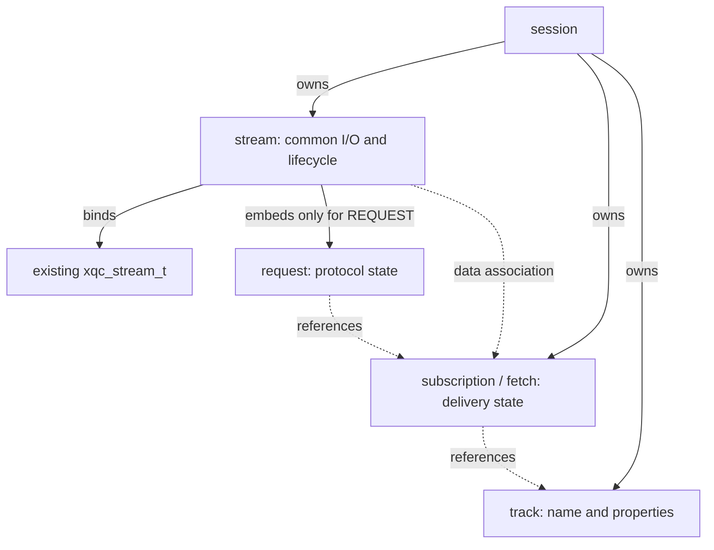
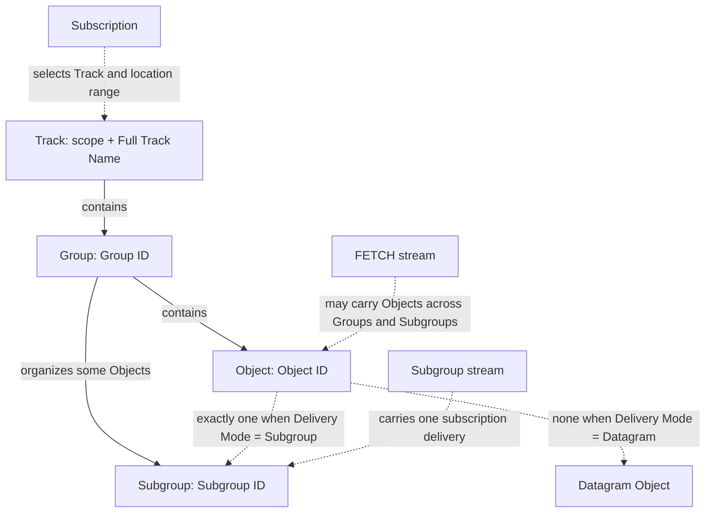

# MoQT Protocol Specification

This shared specification defines endpoint version negotiation, compatibility
boundaries, public interfaces, and the minimum protocol capabilities. The
[relay specification](moqt-relay.md) defines forwarding capabilities for a
separate implementation.

The negotiated version is pinned to **draft-22**, with
[draft-ietf-moq-transport-22][draft] as the normative baseline. This document
defines target behavior and implementation constraints; it does not imply
that the default branch implements every capability or automatically follows
later drafts. Current specification completeness, implementation status, and
interop dependencies are maintained in the [capability table][completeness].
Existing draft-05 and private fast-RTT/0-RTT paths must remain compatible.

## Stable Naming and Compatibility Boundaries

The implementation SHALL use `moq/moqt/`, `include/moq/xqc_moqt.h`, and
`xqc_moqt_*` / `XQC_MOQT_*` names. Types, members, functions, files, and
tests follow codec, session, request, and QUIC-adapter responsibilities.
Subsequent drafts evolve in the same module; do not duplicate a directory for
each revision or embed a draft number in general-purpose symbols.

`XQC_MOQT_VERSION_DRAFT_22` and `XQC_MOQT_ALPN_DRAFT_22` permanently mean
22 and `moqt-22`. Only this configuration is currently accepted. A client
configured for 22 offers only `moqt-22`, without automatic fallback. A server
registers both protocols and dispatches by the ALPN selected for that
connection. A later version requires explicit version selection and wire
semantics; it must not redefine existing constants or accept unknown versions.
A configuration/negotiated-ALPN mismatch rejects Session creation without
sending SETUP or notifying readiness.

The legacy `xqc_moq_*` API, `include/moq/xqc_moq.h`, and
`moq/moq_transport/` retain their draft-05 and private fast-RTT/0-RTT
semantics where available. Comments at their public declarations, SETUP, and
codec entry points SHALL explain this boundary. New protocol entry points,
message codecs, and stream-state-machine comments SHALL identify draft-22 as
the current wire contract. Version-independent names do not imply wire
compatibility across drafts.

<a id="rebuild-review"></a>

## Implementation Outline and Architecture

Endpoint dependencies progress from codec to Session/Request,
Track/Subscription, Object/Fetch/Fill, and discovery/query operations.
Resumption, nonzero filters/Token Aliases, prefix subscriptions, and deployment
capabilities extend the same module. Scope and status are recorded in the
[capability table][completeness]; remaining implementation order is in the
[task outline][tasks].

```text
Publisher / Subscriber applications    Relay service (separate implementation)
                    \                  /
                     Public xqc_moqt_* API
          session / request / track / object / fetch / codec
                           QUIC adapter
                        QUIC transport + TLS
```

| Layer / path | Responsibilities and boundaries |
| --- | --- |
| `include/moq/xqc_moqt.h` | Separate public API, borrowed message/object views, and callback contracts |
| `moq/moqt/xqc_moqt_codec.*` | Framing and message/object-header codecs; reuse common vi64, naming, and KVP utilities |
| `xqc_moqt_session.*` / `xqc_moqt_quic.c` | Session/Stream, SETUP, RX/TX, budgets, timers, and Native QUIC callback adaptation |
| `xqc_moqt_request.c` | Request IDs, response/update FIFO, authorization, type-specific state, and cancellation |
| `xqc_moqt_track.c` / `xqc_moqt_object.c` / `xqc_moqt_fetch.c` | Subscriptions, active-content summaries, incremental object delivery, and independent FETCH/Fill lifetimes |
| Application | Authorization decisions, Track metadata, historical-object existence and data sources, media adaptation, and cross-session application policy |
| Relay | Cross-session routing, aggregation, fanout, and caching through public endpoint APIs; see the [relay specification](moqt-relay.md) |

`XQC_ENABLE_MOQ` controls both protocols. Reuse xqc allocation, iovec,
parameters, var_buf/list_buf, timers, and native stream/datagram/reset
facilities. Do not duplicate integer, container, or transport-recovery
implementations. The protocol layer owns application queues and resource
budgets, without reimplementing QUIC flow control, retransmission, or
congestion control. Media payloads remain opaque.

Non-relay endpoints may implement the subset needed for their task under
[§1.6][s1.6]. Recognized but unsupported operations are handled separately
from unknown messages. Phased Relay scope does not waive support for all
messages or full §7 conformance.

### Integration, Authorization, and Resource Policy

Applications create a Session in `conn_create_notify`, call
`session_start` after handshake completion, and finally destroy it in the
connection-close callback. The Session copies configuration and local SETUP
and owns protocol/datagram user data; transport user data remains
application-owned. Readiness is notified exactly once, after the QUIC
handshake, full submission of local SETUP, and successful validation of peer
SETUP.

The required `on_setup` callback supplies authority/path/token policy after
library format and direction checks. Initial requests and updates invoke
`on_authorize` before `on_message`, passing the merged candidate target.
XQC_OK/XQC_ERROR indicate allow/deny; an output parameter supplies the error.
The default denial is UNAUTHORIZED. A missing application handler produces
NOT_SUPPORTED followed by FIN.

Sending validates and copies a frame before accepting it into a bounded
queue. Writable callbacks resume partial writes/AGAIN without committing state
twice. Budgets include allocated capacity, queue/buffer headers, and empty FIN
entries, rather than payload bytes alone.

| Resource | Default / fixed boundary |
| --- | --- |
| Retained stream contexts | 128, including control, unclassified, and transport-release-pending streams |
| Session RX buffers, queued frames, and retained names | 1 MiB combined, including queue/buffer headers and name updates; fixed contexts also obey the stream-count limit |
| Peer Request ID history | 128 merged intervals, retaining duplicate detection while allowing reordering; exhaustion closes the session without deleting old IDs |
| Unanswered REQUEST_UPDATEs per stream | 16, advertised in SETUP; peer zero/omission means unlimited receive concurrency |
| SETUP, incomplete messages, and unanswered requests | 30 seconds; control-stream timeout closes the session, request timeout cancels that stream |
| Complete control-message body | 65535 bytes; at most 32 namespace fields and 4096 combined namespace/name bytes |
| Options/properties/parameters per message | At most 64 each; immutable-property inspection depth at most 8 |
| Token Alias cache / Range Filter ranges | Baseline and defaults are zero; nonzero support follows the designs below, with independent receive allowances and no inherited old-session credit |

These are local resource policies, not a promise to accept every valid
message size. Control-stream corruption, SETUP timeout, and unknown types are
session errors. Receive-budget exhaustion on an identified data stream resets
only that stream. Basic partial writes, backpressure, cancellation, and error
isolation accompany each feature; unbounded buffering must not bypass limits.

<a id="entity-structure-design"></a>

## Entity Structure Design

This section maps protocol entities to structs and defines shared state and
lifetime boundaries. Stream holds generic I/O and lifecycle state; Request
holds only request-interaction state. Delivery state is independent of its
request stream. Shared Group/Subgroup summaries participate in object send,
receive, and reclamation paths. Validation covers summaries still referenced
by delivery, without retaining a complete Object history.

### Protocol Entities and Struct Mapping

Implementation status is in the capability table. “Reuse” means an existing
general-purpose facility. Each protocol concept need not correspond to a
separately allocated C object.

| Entity / concept | XQUIC representation | Responsibilities and minimum state | Constraint |
| --- | --- | --- | --- |
| Session | `xqc_moqt_session_t` | Configuration, transport, SETUP/readiness, streams, Request ID allocation/deduplication, resource budget, close state | Stream collection and control pointers refer to Stream |
| Stream | `xqc_moqt_stream_t` | Session, transport stream, kind/direction, RX/TX, parser progress, FIN/reset, deferred release | Generic per-stream I/O, parsing, and closure |
| Request / Request Stream context | `xqc_moqt_request_t`, embedded in the request stream | Initial type/ID, initial response, update credit, request timeout/GOAWAY; no separate I/O queue | Remains an application-facing opaque handle |
| Control Message | `xqc_moqt_message_t` | Type-specific fields and borrowed name, parameter, property, and body views | Borrowed fields own no long-lived state |
| Track Namespace / Track Name | `xqc_moqt_namespace_t` + `struct iovec` | Ordered byte-string tuple and length-delimited name, preserving binary semantics | Borrow input through iovec; no duplicate string container |
| Track | `xqc_moqt_track_t` | Same-direction full name, Largest Object, publisher timeouts, reference count; application data source | No historical-object cache |
| Subscription | `xqc_moqt_subscription_t` | Track, filters, alias, priority, pending updates in both directions, subscription state | Actual stream count, publication completion, late-data deadline, cancellation |
| FETCH / Fill delivery | `xqc_moqt_fetch_t` | Standalone FETCH or Fill context, triggering Request ID, range, order, data stream, completion | Shared representation; Fill additionally references its Subscription |
| Namespace publication/discovery, TRACK_STATUS | Type-specific Request state and existing name containers | Namespace prefix/notification state; TRACK_STATUS is a query | No separate entity per control-message type |
| Group | Internal `xqc_moqt_group_t` summary linked from Track | Observed positions, end boundary, active Subgroups; no Object list | Retained by active-stream references |
| Subgroup | Internal `xqc_moqt_subgroup_t` summary linked from Group | Group, Subgroup ID, Publisher Priority, observed/final Object IDs; independent of a transport stream | Shared cross-stream constraints; parser state stays in Stream |
| Object | Borrowed `xqc_moqt_object_t` view and owning Track context | Group/Object/Subgroup IDs, Delivery Mode, priority, status, properties, payload fragments; distinguish carrier from Delivery Mode | No persistent Object type; preserve legacy media/FEC contracts |
| Object Datagram | `xqc_moqt_object_t` and Session RX path | Resolve association by alias, without a virtual stream/request | Consume and discard padding datagrams |

Entities derive from [§2.1–2.5][s2.1], [§3.1–3.4][s3.1], [§4][s4],
[§6.3–6.4][s6.3], and [§11][s11]. C types, allocation, and ownership are
XQUIC design choices, not draft-mandated memory layouts.



Dashed edges are references without ownership transfer. Incoming subgroups
resolve multiple subscriptions through Track/Alias; FETCH maps to one Fetch.
Datagrams dispatch directly by Alias without creating a Stream.
Namespace/status requests create neither Subscription nor Fetch.

### Group, Subgroup, and Object Relationships

Under draft-22 [§2][s2], the content hierarchy is Track → Group → Object.
Subgroups order a subset of Objects in a Group; they are not mandatory parents
of every Object. These are domain relationships, not mandatory allocations:



#### Identity, Ordering, and Content Dependencies

| Entity | Identity / key | Association constraints |
| --- | --- | --- |
| Track | Full Track Name within a MOQT scope: Namespace tuple + Name | Scope follows connection context; sharing a Track within a Session and publisher direction is a runtime association, not global content identity |
| Group | Track + Group ID | Group IDs are Track-scoped join points, not arrival order or QUIC Stream IDs |
| Subgroup | Track + Group ID + Subgroup ID | Group-scoped ID; Publisher Priority is consistent within a Subgroup and is not part of its key |
| Object | Track + Group ID + Object ID | Subgroup ID, priority, Track Alias, Request ID, and transport stream are not identity fields; subscription and FETCH retrieve the same content |

Object ID is a position **within a Group**, not a sequence restarted at zero
within each Subgroup. Subgroups may interleave Object IDs. Changing Subgroup
ID does not create another Object with the same Group/Object IDs. Datagram
Delivery Mode has no Subgroup ID and is not Subgroup 0; actual Subgroup 0 is
valid. Payload identity is independent of transport. Mutable Properties are
distinct from immutable properties; the complete Properties bytes need not be
identical on every delivery.
[§2.1][s2.1], [§2.2][s2.2], [§11.1.2][s11.1.2]

Groups SHOULD be independently usable. Subgroups collect Objects suitable for
ordered reliable delivery at a shared priority; they do not define a media
dependency graph. The library infers neither GOP/frame types nor inter-Subgroup
dependencies and does not turn the cross-Group independence SHOULD into a
wire rejection. Group IDs generally follow content time, but Groups may arrive
out of order. Group Order affects delivery order. Object IDs increase within
one Subgroup stream, possibly with gaps. Unobserved IDs are not thereby known
to be nonexistent.
[§2.1.2][s2.1.2], [§2.2][s2.2], [§2.3][s2.3]

For example, in Track T / Group 8, Subgroup 0 contains Objects 0 and 3,
Subgroup 2 contains Objects 1 and 4, and Object 2 uses Datagram Delivery Mode.
Their keys are T/8/0 through T/8/4. A stream jumping from 0 to 3 does not prove
Objects 1 and 2 nonexistent. Group 9 may reuse Subgroup 0 independently of
T/8/Subgroup 0. FETCH preserves each Object's Delivery Mode and applicable
Subgroup ID even when returning them on one stream.

#### Mapping §2 Object Fields to Existing Structs

Codecs reconstruct omitted, inherited, and delta-encoded fields before
delivering normalized domain views. Wire flags and encoding history are not
new identity fields. This field contract does not imply that every cross-object
check is implemented.

| Protocol field | Existing member / context | Resolution and constraints |
| --- | --- | --- |
| Track Namespace, Track Name | `subscription->track`, `fetch->track`, `stream.state.data.track`; `track->name` owns the name | Subscription data resolves Track by Alias; FETCH resolves Fetch by Request ID, then Track; Object views copy neither names nor aliases |
| Group ID | `object.group_id` | Explicit in Datagrams, fixed by a Subgroup Header, reconstructed using FETCH Group Order/deltas; FETCH records may change Group |
| Object ID | `object.object_id` | May imply zero in a Datagram; Subgroup first ID is absolute, later IDs are previous + delta + 1; FETCH has separate delta rules |
| Publisher Priority | `object.priority`; effective value in Subgroup summary | Explicit, subscription-default, or previous FETCH value; distinct from `subscriber_priority`, never part of Subgroup identity |
| Delivery Mode | `object.datagram`: 1 = Datagram, 0 = Subgroup | Actual carrier for subscription delivery; Datagram Serialization Flag for FETCH; no second mode member |
| Subgroup ID | `object.subgroup_id`, valid only for actual Objects with `datagram == 0` | Header selects zero, first Object ID, or explicit ID; FETCH reconstructs by its own mode; ignore for Datagram, without an integer sentinel for absence |
| Object Properties | `object.properties`, raw KVP iovec view | Interpret under property rules and preserve bytes; no duplicate property containers per Group/Subgroup |
| Payload | `object.payload`, `payload_length`, `payload_offset` | Current callback fragment, complete length, and current offset; no additional entity; empty Normal Objects are valid |

The borrowed Object view holds these fields without a second `object_info`
or persistent Object struct. A NULL `on_object` stream means delivery in a
Datagram; a non-NULL stream may be FETCH. Interpret stream kind together with
`object.datagram`; pointer presence does not establish Subgroup membership.
[§11.2.1][s11.2.1], [§11.3.1][s11.3.1], [§11.4.1][s11.4.1]

`status`, `range`, `end_of_group`, and `first_in_subgroup` communicate
boundaries/knowledge, not additional §2.1.1 identity fields. Their validity
differs by message:

| Signal | Meaning and scope |
| --- | --- |
| `status == 0` | Normal; empty payload does not mean missing or ended |
| `status == 3/4` | Group/Track end in subscription delivery; that position and the corresponding following range do not exist, rather than identifying an empty Object; FETCH encodes no Object Status |
| `range != 0` | FETCH range record, not an Object; interpret only endpoint and category, ignoring Subgroup, priority, properties, and payload; unknown/timed-out does not mean nonexistent |
| `end_of_group` | Datagram bit excludes later Object IDs; Subgroup Header bit establishes an end only after FIN at a complete Object boundary, never on reset |
| `first_in_subgroup` | FIRST_OBJECT identifies the original publisher's first Object in that Subgroup, not the first observed on this connection/subscription/FETCH |
| Object existence | §2.1.2 unknown / exists / does-not-exist, separate from wire status, payload completion, and Stream FIN |

FETCH range records update subsequent Group/Object encoding references.
Previous Subgroup ID and priority still come from the preceding actual Object.
This history belongs to the Stream parser; a range endpoint is not an Object
with a Subgroup and priority.

Represent retained nonexistence knowledge as location intervals, without
allocating an Object per sparse ID. Ordinary nonexistence is permanent. A late
Object received through another delivery path after such a range is not itself
a malformed Track and cannot restore exists state. Prior Group/Object ID Gap
has a separate explicit “will never exist” contradiction rule; apply
[gap and malformed handling](#properties-cache-and-malformed), not that late
arrival exception.
Historical comparison of full payloads/immutable properties and existence
indexes spanning reclaimed entities remain incomplete. This design does not
implement them by caching every payload.
[§2.1.2][s2.1.2], [§11.1.1][s11.1.1], [§11.4.1][s11.4.1]

#### Minimal Shared State Versus Transport State

`stream.state.data.object` holds the current Object and per-stream parsing
history. Multiple subscriptions, restarted Subgroup streams, and FETCH may
observe the same logical entity. Priority or final position stored only in
one Stream cannot validate concurrent deliveries. Therefore, retain small
Group/Subgroup summaries under Track as needed, extending existing structures
elsewhere. Do not allocate per-Object entities, cache payloads, or introduce
a relay data source.

| Internal structure | Minimum state | Excluded responsibilities |
| --- | --- | --- |
| Existing `xqc_moqt_track_t` | Name/direction/Largest Object, Group-summary links, known Track end boundary | Largest Object is not the final Object; no copied request filters |
| Internal `xqc_moqt_group_t` | `group_id`, greatest observed Object ID, known end boundary and validity bits, active Subgroups, lifetime references | No complete Object list, names, aliases, requests, or I/O queues |
| Internal `xqc_moqt_subgroup_t` | Group, `subgroup_id`, effective Publisher Priority, observed minimum/maximum Object IDs, known first/final IDs and validity bits, lifetime references | No unique Stream binding, RX/TX, payload offset, request state, or media dependency graph |
| `xqc_moqt_stream_t.state.data` | Current Group/Subgroup references, existing Object, flags, FETCH history, buffer offsets, FIN/reset | A stream's last parsed Object is not a shared entity's global final state |
| Existing `xqc_moqt_object_t` | Borrowed value view above; Track from delivery context | Owns no Group/Subgroup/Stream lifetime; no new Object handle |

Summaries retain only validation values, not complete Objects. Maximum
observed position detects a smaller end boundary arriving after a larger ID;
minimum position checks whether a late FIRST_OBJECT excludes an already
observed Object. The stream's previous Object serves only its own delta
decoding. All boundaries require validity bits because ID zero is valid.
An end marker supplies an exclusive upper bound; an Object's END_OF_GROUP
bit or FIN supplies an inclusive bound. Preserve the boundary kind rather than
normalizing with `id + 1`, which would overflow at UINT64_MAX. Track boundaries
use `xqc_moqt_location_t`.

Track owns Group summaries; Group owns Subgroup summaries. Data-stream
references keep them alive. A SUBGROUP stream references one Subgroup and
therefore its Group. FETCH uses its Fetch's Track and changes current
Group/Subgroup while parsing actual Objects; Datagram Delivery Mode acquires
no Subgroup. Range records update decoding history/range knowledge without
inventing entities. Datagram RX briefly looks up the Group without creating a
Stream or Subgroup 0. Before association is known, use the existing bounded
waiting path without creating anonymous Tracks/Groups.

Create summaries lazily from actual observations using existing lists,
allocation, and the Session memory budget. The minimum design shares only
summaries referenced by delivery and reclaims unreferenced entries; it is not
an unbounded history table. Reset/release removes only the current stream's
references and cannot erase boundaries another stream uses. Track retains its
own end boundary. Full validation beyond summary retention requires a bounded
interval index or application data source; this design does not claim complete
§12.1 coverage. Contradictory retained evidence cancels the corresponding
same-publisher Track subscriptions/FETCHes as malformed, rather than merely
resetting the current stream and accepting further Track data.
[§12.1][s12.1]

These two internal summaries are needed because shared cross-stream state has
a different lifetime from Stream. Legacy draft-05 media/FEC Objects and
request structures cannot own it. They expose no create/destroy API and add
no version suffix, generic entity registry, or duplicate integer/container
utilities. Existing callback signatures and Object layout remain unchanged.
Normalize fields before shared validation. Summary-allocation and FIN-queue
failure must not commit a new Object or end boundary.

#### Mapping Delivery to Shared Summaries

A Datagram supplies one complete borrowed Object, with NULL `on_object`
stream. Unknown aliases are discarded. Each established same-alias
subscription filters and receives independently. Sending retains no caller
bytes or retry queue. MSS overflow returns `-XQC_EDGRAM_TOO_LARGE`; budget
exhaustion returns `-XQC_EMALLOC`; the application retries after AGAIN.
Failure commits neither Object nor end boundary.

Track embeds the most recent Group value summary and lazily allocates active
Groups/Subgroups from actual Objects. Empty streams hold only Track. Reclaim
a Subgroup after its last reference, retaining Group values in the recent
summary. Reset does not disturb boundaries referenced by other streams.
Replacing the recent summary does not retain full history. Each subscription
fixes its default Publisher Priority at establishment; another same-name
subscription cannot overwrite it.

Subgroup Stream retains the current header, raw properties, and payload
offset. RX holds only the maximum property/vi64 header and a bounded read
chunk; remove delivered payload immediately. Each `on_object` reports total
length, offset, and the same raw properties. Bytes expire when the callback
returns; large Objects are not fully buffered.

`subgroup_open()` specifies subscription, Group/Subgroup IDs, priority,
FIRST_OBJECT, and END_OF_GROUP. `stream_send_object()` copies one fragment.
Continuations match metadata and the next offset and omit properties. Only OK
advances state; AGAIN does not. `stream_finish()` sends FIN only at a complete
Object boundary; `stream_cancel()` resets. Pause/cancel resets associated
streams whose FIN is not sent. Receivers stop a shared stream only when no
matching same-alias subscription remains.

`on_stream_closed` fires once; its handle expires on return. Last-Object
metadata contains no borrowed bytes. Only complete FIN establishes
END_OF_GROUP; reset does not. Truncated FIN, delta overflow, and invalid headers
are session errors. Malformed properties are handled at Track scope.
Scheduling reuses existing TX; see [send-queue mapping](#priority-scheduling-design).

<a id="delivery-lifecycle"></a>

#### Delivery Completion and Timeouts

Delivery state is independent of the request stream. Sending `PUBLISH_DONE`
requires all subscription data streams to have submitted FIN/reset with empty
TX queues. Replace caller Stream Count with the actual number opened,
including empty Subgroups and Fill. Reject new Objects/data streams afterward;
accepted Datagrams are no longer retained by the library. The receiver keeps
the Alias association until counts match, cancellation occurs, or bounded
waiting expires. Physical request closure only clears its reference, retaining
late-data delivery. Graceful FIN is not cancellation. [§9.9][s9.9]

`on_subscription_closed` is the final notification; the handle expires on
return. `subscription_cancel()` remains valid after request-stream closure.
Cancellation stops only data streams with no other active subscription
reference. Multiple same-alias subscriptions cannot independently attribute
stream counts, so wait conservatively for the local deadline. Unknown counts
and lost headers also use `config.timeout` in microseconds, default 30 seconds.
This §9.9 early-completion policy may discard later Objects and is timed
separately from Object/Subgroup Delivery Timeout.

For §5.2 delivery timeouts, Track holds publisher defaults and Subscription
holds subscriber parameters. The FIRST_OBJECT-marked first Object first
overrides the corresponding publisher value; then use the minimum nonzero
publisher/subscriber value. Do not simply minimize Track, first-Object, and
subscriber values together. Later Objects' same-name properties do not change
Subgroup policy. If both endpoints specify nonzero values, use the smaller;
zero means unlimited. Recognize both mutable and immutable properties.
Retain the application header-submission timestamp per accepted Object;
continuations preserve it. Existing list_buf queue nodes add only a timestamp.
Before sending/resuming partial writes, check expiry, reset the Subgroup, and
return EEXPIRED. Datagrams add no queue: before QUIC submission, check the
minimum nonzero of the two timeout kinds, discard expired Objects, and return
EEXPIRED.

The first valid `stream_finish()` starts the Subgroup timer when the
application declares publication complete. Preserve that start even if FIN
queueing returns AGAIN. Continue timing after QUIC accepts FIN until native
send state confirms all bytes acknowledged or the stream closes. Updated
subscription limits still use the original finish time. Expiry resets with
DELIVERY_TIMEOUT; a closed Session must not reschedule its transport
connection. With negotiated RESET_STREAM_AT and a QUIC-accepted header,
reuse the native reliable-prefix API to preserve the Subgroup/Fetch Header.
Paired tests cover normal completion and timeout isolation. Explicitly test
“FIN sent, ACK lost”; ordinary FIN completion is insufficient. Per-Object
retransmission deadlines after QUIC submission remain constrained by native
transport support. [§5.2][s5.2], [§11.3.2][s11.3.2]

#### One Subgroup Across Multiple Delivery Streams

A subscription's Subgroup stream cannot mix Subgroups. Usually one stream
delivers one Subgroup for one subscription, but early reset/upstream
reordering under §2.2 may require subsequent streams. Do not encode this
usual relationship as a unique Stream pointer in Subgroup. Deliveries for
other subscriptions and cross-Group/Subgroup FETCHes cannot share that unique
slot either. FETCH FIN completes only that retrieval, not every Subgroup it
traverses. [§2.2][s2.2], [§3.2][s3.2], [§11.3.2][s11.3.2]

FIRST_OBJECT and graceful FIN supply beginning/end knowledge respectively.
Empty-stream FIN creates no summary or endpoint. FETCH_OK End Of Track uses
an inclusive End Location regardless of Group Order. FETCH Objects do not
advance live Largest Object. [§9.12][s9.12] FIN does not prove receipt of
Objects before the subscription start. Reset means incomplete delivery,
without proving a logical Subgroup/Group ended or affecting other Subgroups.
Different graceful-FIN final IDs, conflicting effective priorities, and Objects
beyond known ends are checked against retained shared state. Cross-stream
arrival order never affects per-stream delta decoding.
[§11.3.2][s11.3.2], [§12.1][s12.1]

### Stream as Carrier; Request as Type-Specific State

`xqc_moqt_stream_t` binds one transport stream without duplicating QUIC flow
control, retransmission, or congestion control. Internal
`xqc_moqt_stream_kind_t` values are not wire-type values:

| Kind suffix | Protocol use | Request context |
| --- | --- | --- |
| `UNCLASSIFIED` | New stream with incomplete/unvalidated first field | Inaccessible |
| `CONTROL` | Unidirectional Session control stream | No Request handle |
| `REQUEST` | Bidirectional request stream | One embedded context for initial request and later exchanges |
| `SUBGROUP` / `FETCH` | Unidirectional Object data stream | No Request handle; SUBGROUP associates Track/Subscription, FETCH associates Fetch |
| `PADDING` | Unidirectional padding stream | No Request handle |

Use the `XQC_MOQT_STREAM_*` prefix. SUBGROUP/FETCH share Stream I/O buffers.
Remain UNCLASSIFIED until the complete valid first field arrives; select the
context only after direction/type validation. Session enforces CONTROL
uniqueness, without contradictory control/padding classification booleans.

Only REQUEST accesses `state.request`; other kinds have no valid Request
handle. SUBGROUP/FETCH use `state.data`. Allocate Stream and Request together
with one RX/TX pair and stream count, not a second heap object for layering.
Session `streams`, `control_tx`, and `control_rx` all point to Stream.
`pending_*_updates` counts unanswered updates, not cumulative messages.

Place state by scope: incomplete-input timeout and FIN/reset in Stream;
initial/update responses and request GOAWAY in Request; SETUP, Session
GOAWAY, and connection budget in Session. `PUBLISH_DONE` is a request event,
not `tx_fin`/`rx_fin`. Subscription owns data-stream counts/waiting state.

### Identifiers and Associations

| Identifier | Storage / association |
| --- | --- |
| QUIC Stream ID | Existing transport stream; read for logging/query without copying into Request ID |
| Initial Request ID | Immutable `request.initial_request_id`, returned by `request_id()` |
| REQUEST_UPDATE Request ID | Current message's `request_id`, allocated by Session; multiple update IDs may share a request stream |
| Track Alias | Session- and publisher-direction-scoped association; not a full name, Request ID, or unique Subscription pointer |
| Group ID | Group key with Track; value in Object view, association in shared summary |
| Subgroup ID | Valid only for Subgroup Delivery Mode; key with Track and Group ID, excluding priority |
| Object ID | Object key with Track and Group ID, never restarted per Subgroup; none of these IDs derives from Stream ID |

An initial request establishes a request stream; REQUEST_UPDATE stays on it.
Responses associate by stream and response order; update IDs still participate
in Session-wide duplicate detection. [§6.4.2][s6.4.2], [§9.5][s9.5]
“One stream per request” refers only to the initial operation, not each update.

Update counters enforce response order/credit. Fetch `info.request_id`
stores the triggering message ID independently of Request counters.
Association count/memory is budgeted to Session. Returning credit on update OK
must not discard Fill associations whose data is pending/incomplete. Initial
Request ID deduplication history cannot replace these active associations.
Late headers after cancellation/delivery termination follow terminal handling
without resurrecting requests. Graceful request-stream closure is not delivery
termination; pending data still uses retained delivery associations.
[§3.4][s3.4], [§11.4.1][s11.4.1]

One Track may have multiple subscriptions; an Alias may map to multiple
subscriptions of that Track. RX dispatches by filters rather than exclusively
binding a data stream to the first matching Request. Standalone FETCH and
Fill associate by Request ID, not Subgroup/Datagram Track Alias lookup.
[§3.1.3][s3.1.3]

### Ownership, Closure, and Callbacks

Session owns MoQT Stream contexts; transport owns `xqc_stream_t`.
`xqc_moqt_io_t` stream operations and QUIC stream user data use Stream.
Stream dispatches to Session control handling or Request state. Transport
callbacks must not cast every stream to Request; Request APIs cannot operate
on CONTROL/PADDING contexts.

A Request handle borrows its embedded state and represents only the request
exchange. `on_request_closed` fires once for an established Request context;
its handle expires on return. Unclassified, control, and padding stream
reclamation does not emit this notification. Release Stream only after
transport callbacks and the current call stack finish. Session outlives all
child contexts and associated callbacks.

FIN closes only the sending direction; cancellation uses reset/STOP_SENDING
on still-open directions. Abnormal control closure is a Session error;
request-stream closure follows its Request state. Reusing low-level close
functions must not conflate error scopes.
[§6.3][s6.3], [§6.4.2][s6.4.2]

Session manages Subscription/Fetch delivery independently of Request or any
single data stream. Clear non-owning Request references before the handle
expires; preserve required IDs/state separately, without dangling Stream
pointers. `on_request_closed` does not mean all Objects arrived. Subscriptions
complete through PUBLISH_DONE, data-stream counts, and bounded waiting.
FETCH distinguishes control-response completion from data-stream completion.
[§9.9][s9.9], [§3.2.4][s3.2.4] These lifetimes apply to Subscription,
standalone Fetch, and Fill.

Message, namespace, and payload views retain the borrowing contract above.
The actual owning entity copies names/parameters needed across callbacks into
existing common buffers. Do not duplicate the same message/name/payload in
every struct.

### Reusing Existing Structures and Migration Scope

| Existing facility / structure | Treatment and rationale |
| --- | --- |
| `xqc_stream_t`, connection callbacks, ALPN registration | Reuse transport directly; the new MoQT Stream holds only application-protocol context |
| `xqc_moqt_request_t` | Request state embedded in Stream, without duplicate I/O |
| Legacy `xqc_moq_stream_t` | Retain draft-05 parsing, old Track/Group headers, and media/FEC use; replacing its Session pointer cannot implement new semantics |
| Legacy `xqc_moq_track_t` / `xqc_moq_subscribe_t` | Old Track mixes media packaging and one alias/subscribe_id; old Subscribe owns old messages. New state holds full names, shared alias associations, and updates without changing old layouts |
| Legacy `xqc_moq_object_t` | Old subscribe_id/send_order, media/FEC and timing metadata retain their meaning; the new Object is a borrowed view reusing iovec/integer utilities |
| Byte strings, parameters, buffers, queues, integers | Reuse iovec, existing parameters, var_buf/list_buf, and common vi64; no synonymous containers/codecs |

See the legacy [Stream][legacy-stream-types], [Track][legacy-track-types],
[Subscribe][legacy-subscribe-types], and [Object][legacy-message-types]
definitions. New entities must not change legacy public ABI to share layouts.
Any future entity must explain why limited extension of an existing layout
cannot work. Keep extractable common behavior in one implementation; shared
utilities carry neither legacy wire parsers nor media policy.

Public `request_open/send/finish/cancel/id` semantics and callback signatures
remain. Object I/O uses the new subgroup/stream/fetch APIs. Request
`finish` still closes only the local sending direction. Legacy APIs,
version/ALPN consistency, and legacy 0-RTT constraints remain. Internal
accept/feed/flush/transport callbacks use Stream; codecs still use Message.
Session, Track, Object, Fetch, codec, and QUIC-adapter responsibilities stay
in the same version-independent module.

### Acceptance Constraints
Stream is the carrier; Request is embedded type-specific state with an opaque
handle. Delivery has an independent endpoint lifetime. The following are
acceptance requirements, not passing results:

| Scope | Normal case | Abnormal / boundary case |
| --- | --- | --- |
| Classification | Fragmented SETUP, requests, and padding reach their respective kinds | Incomplete first type exposes no Request; reject invalid type/direction; control corruption closes Session |
| Requests/updates | One initial ID and several update IDs share a bidi; initial ID stays fixed | Handle duplicates, excess updates, early FIN; local cancellation isolates other requests |
| Memory/callbacks | Resume partial sends, close Request once, return budget to zero | Reentrant cancel/close, cancel after FIN, unclassified destruction without UAF, duplicate notification, or leak |
| Delivery | Associate late data after PUBLISH_DONE, Fill after update OK, and multiple same-alias subscriptions | Late data/completion after cancellation only cleans up, without stale Request access or terminating another subscription |
| Object identity/fields | Interleaved IDs in multiple Subgroups, Datagram alongside Subgroup 0, original FETCH Delivery Mode | Range is not an Object; empty Normal is not an end marker; restore omitted/inherited fields correctly |
| Shared boundaries | Multiple streams/subscriptions retain valid Group/Subgroup references after local cancel | Detect priority/final-ID conflicts and smaller late ends; reset/FETCH FIN must not imply Group/Subgroup completion; maximum IDs do not overflow |
| Knowledge/reordering | Gaps stay unknown; cross-Group reordering preserves per-stream decoding | Late Object after ordinary nonexistent range is not falsely malformed; reclaimed summaries do not imply complete history; release unreferenced summaries/views |

Verify one set of Stream I/O storage and unchanged legacy API/ABI/resumption.
Borrowed messages, names, and payloads expire on callback return; actual owners
copy retained data into common buffers. `on_closed` starts Session termination;
Request notifications may follow. Application user data survives through
`session_destroy`. Protocol callbacks may close/cancel/send but not directly
destroy. Active closure wakes idle QUIC to send CONNECTION_CLOSE.

<a id="transport-versions"></a>

## Version, Mode, and Negotiation Contract

### Version Support Matrix

| Protocol / mode | Status and integration | Native QUIC ALPN | Identification and boundary |
| --- | --- | --- | --- |
| draft-22 | Explicit version 22; server accepts old/new clients; subset in capability table | `moqt-22` | ALPN determines version; no legacy version list in SETUP; default 1-RTT, explicit opt-in for future Native QUIC resumption |
| Legacy draft-05 | Existing `xqc_moq_*` calls and defaults | `moq-quic` | Existing CLIENT_SETUP/SERVER_SETUP selects `XQC_MOQ_VERSION_5` (`0xff000005`) |
| draft-05 fast-RTT v1 | Preserve `XQC_MOQ_EXT_CONFIG_FLAG_FAST_RTT` where provided | `moq-quic` | Private `XQC_MOQ_VERSION_5_FAST` (`0xfff00005`); existing SETUP version list still includes draft-05 |
| draft-05 fast-RTT v2 / fast ALPN | Preserve `XQC_MOQ_EXT_CONFIG_FLAG_FAST_RTT_ALPN` where provided | `moq-fast-rtt-alpn` | Private `XQC_MOQ_VERSION_5_FAST_ALPN` (`0xfff00006`); retain precreated Tracks and 0-RTT path |

Legacy rows describe compatibility protocols, including private extensions;
they do not claim `moq-quic` is the IETF draft-05 standard ALPN. See existing
[public declarations][legacy-api], [version constants][legacy-version],
[session establishment][legacy-session], and [handshake handling][legacy-handler].
The public baseline provides draft-05; private fast-RTT APIs described here
are compatibility constraints for distributions that already provide them,
not additions made by this draft-22 port. New draft-22 follows the
`moqt-<draft number>` rule in [§6.2][s6.2]; adding `0xff000016` to old
SETUP cannot substitute for implementing the new protocol.

### Meaning of Legacy 0-RTT

0-RTT is QUIC/TLS resumption early data, not another MoQT draft version.
A fast-RTT flag alone does not authorize early data. Legacy fast-RTT reduces
application establishment round trips; actual 0-RTT also requires a valid
ticket, remembered parameters, and transport early-data eligibility.

Where available, v2 calls `xqc_moq_fast_rtt_alpn_pre_setup()` when
`xqc_conn_is_ready_to_send_early_data()` is true; otherwise handshake
completion continues establishment. Preserve existing media, catalog,
datachannel, preset alias/subscribe IDs, and old SETUP behavior; see the
[client call chain][legacy-client]. Legacy SETUP version preference is not
draft-22 downgrade policy.

Draft-22 0-RTT is separately implemented and validated under the
[resumption design](#moqt-0rtt-negotiation) and [§6.3.1][s6.3.1].
New endpoints disable early data by default. Explicit opt-in must not alter
legacy interfaces/state. Isolate caches by peer and protocol/ALPN; do not
carry old fast-RTT Session state, preset aliases, or eligibility into draft-22.

### ALPN Negotiation

Compatibility is server-side. Clients select the target before connecting.
For version 22, `config_alpn` returns `moqt-22`; `xqc_moqt_connect` passes
only that ALPN to existing `xqc_connect`. Legacy clients explicitly use
`moq-quic`, or private `moq-fast-rtt-alpn` where available. Clients send
no old/new candidate list and do not reconnect with an automatic downgrade.

Servers register legacy and `xqc_moqt_init_alpn` handlers independently on one
engine, supporting `moq-quic` and `moqt-22`. Existing TLS selection and
engine callback lookup dispatch to the matching parser/session. Compatibility
accepts old clients by ALPN; it never uses old wire semantics inside a
`moqt-22` connection. A single client ALPN needs no new server preference API.

Under [RFC 7301 §3.1–3.2](https://www.rfc-editor.org/rfc/rfc7301.html#section-3.2),
a server selects only an offered, supported protocol. No overlap fails with
`no_application_protocol`; a 22 client cannot connect to an old-only server.
Actual ALPN alone determines parser, callbacks, and Session; global version
state cannot replace per-connection identity.

| Client's sole ALPN | Server support | Expected result |
| --- | --- | --- |
| `moqt-22` | `moqt-22`, `moq-quic` | Select `moqt-22`; new handler only |
| `moq-quic` | `moqt-22`, `moq-quic` | Select `moq-quic`; legacy SETUP/Session succeeds |
| `moq-quic` | `moq-quic` | Preserve draft-05 behavior |
| `moqt-22` | `moq-quic` | Explicit no-common-ALPN failure |

Implementation boundaries:

- Preserve public `xqc_connect`, `xqc_h3_connect`, and internal client/TLS
  interfaces/layouts. Add no ALPN list, candidate count, preference API, or
  delayed-creation branch.
- `xqc_moqt_connect` validates protocol configuration/local DATAGRAM, then
  uses the existing single-ALPN entry point. A client registers only its chosen
  protocol; legacy registration is optional.
- Register handlers separately without overwriting callbacks/contexts.
  Preserve creation, handshake, close timing, ownership, and legacy fast/0-RTT.
- The modern entry point currently supports 1-RTT only, rejecting tickets and
  cached transport parameters. Future resumption remains isolated and does not
  reuse old precreated Tracks, aliases, or early data.

Validate every matrix row: successful paths check actual ALPN at both ends,
exactly one matching create callback, no other-version handler, and graceful
closure. Both legacy combinations complete draft-05 SETUP and verify its
version. Failure paths verify both-end negotiation failure and absence of a
wrong-version server Session. Retain private fast-ALPN handshake regression
where that implementation exists. ALPN success proves only QUIC negotiation
and dispatch; Session readiness still waits for both SETUPs.

`moq_demo_server` registers both ALPNs on one port. `server_accept` creates
only connection context; the post-selection callback creates the legacy
Session, and a 22 connection creates none. `moq_demo_client -v 05|22`
selects explicitly, defaulting to 05. Version 22 tests handshake/SETUP/readiness,
neither reads nor writes old caches, and cannot combine with private `-F`.
Run real demos to check legacy SETUP/media, new SETUP/ALPN, graceful closure,
invalid options, and no common ALPN. The public demo rejects unavailable
private fast-RTT modes explicitly.

<a id="moqt-0rtt-negotiation"></a>

## MoQT 0-RTT Negotiation Design and Constraints

This resumption design is not yet implemented and does not describe currently
available switches. Proposed configuration defaults to zero, preserving
1-RTT. Scope is Native QUIC, `moqt-22`, and point-to-point pub/sub with a
known Full Track Name. WebTransport, Relay discovery, and upstream
subscriptions are excluded.

### Acceleration Mechanisms and Boundaries

Control three capabilities independently; one fast-RTT flag is insufficient:

| Capability | Wait removed | Conditions |
| --- | --- | --- |
| SETUP/request pipelining | Peer SETUP before sending SUBSCRIBE/PUBLISH | [§6.3][s6.3], [§9.1][s9.1]; no extension changing control-message semantics |
| QUIC 0-RTT | Current transport handshake before sending those messages | Valid same-context ticket, ALPN, remembered transport parameters, and application early-data permission |
| Early PUBLISH Objects | PUBLISH_OK before Object transmission | PUBLISH sent, subscription unpaused, [§3.1][s3.1] and [§9.8][s9.8] satisfied |

Pipelining also applies to ordinary 1-RTT. 0-RTT describes client early data;
server responses use 1-RTT protection. It does not guarantee zero handshake,
subscription-confirmation, or first-frame latency. SUBSCRIBE and PUBLISH are
alternative subscription-establishment operations; PUBLISH need not precede
SUBSCRIBE.

### Point-to-Point Exchanges

Downlink: A publishes, B subscribes and initiates QUIC. B already knows the
Track and need not discover a namespace/catalog first.

```mermaid
sequenceDiagram
    participant B as B / QUIC Client / Subscriber
    participant A as A / QUIC Server / Publisher
    Note over B,A: Valid resumption context; server accepts 0-RTT
    B->>A: Initial flight: Initial + 0-RTT
    Note right of B: Local uni control: SETUP<br/>Separate bidi request: SUBSCRIBE
    Note over A: Validate SETUP, request, authorization; accept subscription
    A->>B: TLS handshake + 1-RTT data
    Note left of A: Local uni control: SETUP<br/>Request stream: SUBSCRIBE_OK<br/>Data uni streams / Datagrams: Objects
    Note over B: Validate SETUP; associate Alias; deliver Objects
```

Uplink: A still publishes and B subscribes, but A initiates QUIC, illustrating
a client publisher's early-data path.

```mermaid
sequenceDiagram
    participant A as A / QUIC Client / Publisher
    participant B as B / QUIC Server / Subscriber
    Note over A,B: Valid resumption context; server accepts 0-RTT
    A->>B: Initial flight: Initial + 0-RTT
    Note right of A: Local uni control: SETUP<br/>Separate bidi request: PUBLISH<br/>Data uni streams / Datagrams: Objects
    Note over B: Validate SETUP, authorization, Alias; then deliver Objects
    B->>A: TLS handshake + 1-RTT data
    Note left of B: Local uni control: SETUP<br/>Request stream: REQUEST_OK (PUBLISH_OK)
```

“Initial flight” means one send phase without awaiting a response, not
mandatory packing into one QUIC packet. Each endpoint sends its own SETUP
first on its control stream. Streams have no cross-stream arrival guarantee;
Objects may precede SETUP, PUBLISH, or SUBSCRIBE_OK. PUBLISH_OK is the semantic
name for REQUEST_OK, not a new message.

### Minimal Interfaces and Implementation Mapping

Append only `uint8_t startup_flags` to `xqc_moqt_config_t`, initialized to
zero. Three flags represent independent capabilities, without a fast-RTT
version, resumption handle, or duplicate TX queue.

| Flag | Contract |
| --- | --- |
| `XQC_MOQT_PIPELINE` | Allow existing `xqc_moqt_session_start()` after creation in `conn_create_notify`; before both SETUPs, allow only initial SUBSCRIBE/PUBLISH. Handshake calls start again to flush/check current transport parameters, without another SETUP |
| `XQC_MOQT_EARLY_DATA` | Requires PIPELINE; application permits replay and ensures same-peer/security cache. Client reuses `xqc_validate_0rtt_cache()` for ticket/ALPN/TP; invalid cache falls back to ordinary handshake. Server applies policy in ALPN callback |
| `XQC_MOQT_PUBLISH_EARLY` | Permit unconfirmed, unpaused, uncancelled, unrejected PUBLISH to send/receive using its current Alias; also usable in 1-RTT |

| Entity / path | Responsibility |
| --- | --- |
| Session | Distinguish `started`, `setup_received`, native handshake; `on_ready` still requires handshake and both SETUPs, once per Session |
| Stream | One `deferred` bit waits for SETUP/Alias; reuse RX/FIN/deadline and Session byte/context budgets. Process requests before data; reserve one maximum control frame outside non-control buffering |
| Subscription | Reuse PUBLISH/acknowledgment/pause/rejection/cancel state; callbacks only after authorization; no early-subscription type |
| QUIC adapter | Reuse ticket/TP validation, stream limits, Datagram MSS; enforce remembered connection/stream windows for early writes; never disable native 0-RTT parameter checks |
| Rejection recovery | Native QUIC alone retransmits stream bytes: reset offsets/counts and resend still-valid accepted bytes. MoQT retains handles/unsubmitted TX; cancel/timeout uses reset to prevent resend. Applications do not resubmit the logical request |
| Early Datagram | Remove native automatic fallback buffering; application decides whether to resend still-valid Objects after rejection. Discard unknown-Alias Datagrams without reliability promises; Subgroups use bounded waiting |

Observe handshake outcome through existing
`xqc_conn_get_stats().early_data_flag`, without duplicate notifications.
Record successful response, Object delivery, and handshake separately;
queue acceptance is not subscription success. Defaults and legacy ABI remain.
New fields belong only to this new `xqc_moqt_*` API.

Server responses before handshake completion use 1-RTT keys under
[RFC 9001 §5.7][rfc9001-5.7]; 1-RTT reception still obeys handshake-completion
constraints. Eligibility to send is separate from permission to process
client 0-RTT.

### Enabling and Processing Constraints

1. **Consistent resumption context.** Ticket and parameters come from one
   historical connection, isolated by peer, ALPN, and application security
   context. Never mix draft-05/fast state. Missing qualified cache uses ordinary
   handshake. Rebuild SETUP, requests, and aliases; do not restore old Request
   ID, Track Alias, or Token Alias mappings.
2. **Conservative SETUP assumptions.** Initial requests use baseline draft-22.
   Extensions and operations needing nondefault peer credit wait for current
   SETUP. Initial authorization uses independently decodable tokens, not old
   aliases or unconfirmed registration on another stream. This is the initial
   implementation scope; see [§6.3.2][s6.3.2].
3. **Independent transport limits.** Use remembered connection/stream windows
   and uni/bidi limits, not larger current-handshake values. After handshake,
   validate ALPN and transport parameters. Required DATAGRAM support remains;
   early Datagrams check remembered `max_datagram_frame_size` and actual MSS.
   Incompatibility rejects early data or closes QUIC, never silently accepts.
4. **Bounded reordering buffers.** Pending-SETUP requests and unknown-Alias
   Objects consume Session byte/count/time budgets. Deliver application
   callbacks only after SETUP validation, authorization, and association.
   Reset/discard on excess as permitted. Prioritize control reads/windows so
   data cannot consume the budget needed to establish aliases.
   [§6.3][s6.3], [§3.1.3.1][s3.1.3.1]
5. **Authorization and replay are distinct.** A valid ticket is not current
   application authorization. Check resumption policy before accepting early
   data; defer unsafe side effects until handshake. Deduplicate within logical
   Track/Group/Object identity. Applications control cross-session effects;
   the library does not promise exactly-once. Bound pre-handshake resource
   use. [§6.3.1][s6.3.1]
6. **No double send after rejection.** On QUIC 0-RTT rejection, reset stream and
   associated application state under [RFC 9001 §4.6.2][rfc9001-4.6.2],
   recheck ALPN/parameters, and rebuild still-valid operations in 1-RTT.
   Give retransmission/reconstruction one owner, without duplicate
   SETUP/SUBSCRIBE/PUBLISH. Never resurrect cancelled/timed-out/closed
   requests; terminal callbacks fire at most once. Datagram resend is
   application policy and only for unexpired Objects.
7. **Distinguish transport and application rejection.** PUBLISH_ERROR, pause,
   and invalid SETUP are not 0-RTT rejection. Stop disallowed Objects and clear
   queues on denial/pause without automatically republishing; SETUP failure
   terminates Session. Early senders accept that rejection, pause, or bounded
   buffers may leave Objects unused.

Resumption/limits follow [RFC 9001 §4.6][rfc9001-4.6] and
[RFC 9000 §7.4.1][rfc9000-7.4.1]; DATAGRAM follows [RFC 9221 §3][rfc9221-3].
These transport contracts cannot be replaced by
verification of these contracts by MoQT-layer pipelining alone.

### Acceptance Criteria

These positive/negative paths are requirements; current-head validation
records determine actual results.

| Area | Positive evidence | Abnormal evidence |
| --- | --- | --- |
| SETUP pipelining | Allowed requests precede peer SETUP on 1-RTT and resumed connections | Request/Object arrives first, fragmented/invalid SETUP, buffer exhaustion terminate correctly |
| Downlink | B sends SETUP/SUBSCRIBE in its first flight; A authorizes, responds, delivers | Denial, unknown Track, invalid token deliver no Objects |
| Uplink | A sends Objects before PUBLISH_OK; B associates and delivers | Controlled PUBLISH_ERROR, pause, unknown Alias, duplicate/expired Object |
| Resumption/fallback | Matching ticket/ALPN/TP accepts early data | Missing/expired ticket, early-data rejection, incompatible ALPN/credit; no double send, duplicate callback, old-state leakage |
| Transport/lifetime | Valid uni/bidi/window/Datagram operation | EAGAIN, loss, cancel, timeout, handshake failure, close release all pending state |
| Compatibility | Default-off preserves draft-22 1-RTT | Legacy draft-05/fast paths do not read new caches or change behavior |

State machines require paired unit tests; endpoint interactions require
client/server evidence, or an explicit targeted-case gap. Latency evidence
records initial send, SETUP send/receive, early-data acceptance/rejection,
response, first Object arrival, and application delivery. Packet captures/logs
must identify the removed wait dependency. One low RTT or an enabled 0-RTT
flag is insufficient.

## Public API Compatibility and Changes

The following defines old/new boundaries; see [current status][completeness].
The protocol uses separate `include/moq/xqc_moqt.h` and `xqc_moqt_*` APIs.
Preserve source compatibility, ABI, and defaults of
`include/moq/xqc_moq.h`. Existing applications need no changes to continue
using their existing draft-05/0-RTT capabilities.

### Unchanged Interfaces

| Existing interface family | Preserved contract |
| --- | --- |
| `xqc_moq_init_alpn()`, private `xqc_moq_init_alpn_for_fast_rtt()`, `XQC_ALPN_MOQ_*` | Existing strings/registration where available; never redefine them as `moqt-22` |
| `xqc_moq_session_create/destroy()`, `xqc_moq_session_callbacks_t`, `xqc_moq_user_session_t` | Signatures, layout, handles, legacy lifetime; no draft-22 message structs |
| `xqc_moq_session_get_config/set_config()`, `xqc_moq_session_config_t` where available | Legacy media configuration, including by-value layout; no version field or preconnect repurposing |
| `xqc_moq_track_create()`, `xqc_moq_subscribe/subscribe_latest()`, `xqc_moq_write_subscribe_ok/write_subscribe_error()` | Legacy strings, filters, subscribe IDs, message parameters |
| `xqc_moq_write_video_frame/write_audio_frame/write_datachannel()`, catalog/video/audio callbacks | Media packaging, datachannels, application fields, callbacks; no implicit conversion to Object API |
| Private fast flags, `xqc_moq_fast_rtt_alpn_pre_setup()`, `xqc_moq_is_alpn_matched()` | Existing legacy role where provided; never enter draft-22 negotiation or alter new connection version |
| Bitrate/queue, Track selection/FEC, stats/metrics, application error, CID routing, transport events | Preserve existing symbols, values, layouts, semantics; do not redefine them through this upgrade |
| QUIC engine, `xqc_connect()`, public stream/datagram APIs | Unchanged contracts; integrate protocol through ALPN/application callbacks |

Unlisted existing `xqc_moq_*` symbols are equally preserved. Legacy
`on_client_setup` / `on_server_setup` callbacks, where provided, still
represent old messages; never cast draft-22 SETUP into them. This compatibility
table does not add private interface families absent from the public baseline.

### New Interfaces and Caller Migration

| New interface | Behavior and responsibility |
| --- | --- |
| `xqc_moqt_config_init/config_alpn` | Explicit version 22 only; unique corresponding `moqt-22` |
| `xqc_moqt_init_alpn/connect` | Independent stream/datagram handlers preserving caller connection callbacks; offer one configured ALPN and require QUIC DATAGRAM |
| `xqc_moqt_session_create/start` | Validate configuration/ALPN/handlers and copy configuration at creation; start after handshake, verify peer DATAGRAM, send SETUP; notify ready once after both SETUPs |
| `xqc_moqt_message_encode/decode` | Full-frame syntax/codecs; original request type supplies response context, REQUEST_UPDATE supplies update-response context |
| `xqc_moqt_request_open/send/finish/cancel` | One bidi per initial request, updates on that stream; connection-wide parity/deduplication, cross-stream reordering, credit, FIFO responses, half-close/cancel; application callbacks supply business behavior |
| `xqc_moqt_datagram_send` | One complete Object for an established local-publisher subscription; check location/pause; MSS overflow EDGRAM_TOO_LARGE, expiry EEXPIRED; AGAIN retains no caller bytes |
| `xqc_moqt_request_subscription` | Session-owned SUBSCRIBE/PUBLISH delivery handle; control-message views own no long-lived delivery state |
| `xqc_moqt_session_goaway/close/destroy` | Session/request GOAWAY, finite waiting, reclamation; no version setter, version changes require a new connection |

Object APIs use length-delimited binary names, locations/Delivery Mode, and
incremental payload. Subgroup/Fetch/Fill ownership is in the entity design.
Applications supply historical data, discovery results, Track metadata, and
authorization. The library creates no implicit catalog/cache.

Failed `config_init` preserves its input; invalid `config_alpn` returns NULL.
`xqc_moqt_connect` preserves original connection arguments/CID ownership,
requires local DATAGRAM and ordinary QUIC encryption, and currently rejects
ticket/cached TP without changing inputs. Resumption opt-in is future work.
Connection version is immutable; changing the original configuration has no
effect.

Applications migrating to draft-22 must change integration, request, and data
models, not just a version constant. Retaining high-level media/catalog APIs
over draft-22 needs a separately specified adapter; this baseline promises no
automatic media conversion. Handles are not interchangeable. Legacy error
ranges/message enums are not draft-22 wire values. Implement each new C
signature and ownership comment explicitly.

## Minimum Supported Scope

“Minimum” means endpoints capable of direct publishing, subscribing, live
delivery, and historical Fill, with public interfaces for a future relay.
It is not every optional draft capability. Both publisher/subscriber roles are
required and may coexist in one Session.

| Capability | Endpoint implementation | Boundary / source |
| --- | --- | --- |
| Native QUIC, `moqt-22`, QUIC DATAGRAM | Required | [§6.2][s6.2]; no legacy SETUP version negotiation |
| Two uni control streams, bidi requests, SETUP, GOAWAY | Required | [§6.3–6.6][s6.3], [§9.1–9.2][s9.1] |
| vi64, framing, namespaces, properties | Required | [§8][s8], [§9][s9] |
| SUBSCRIBE, PUBLISH, generic responses, updates, termination | Required | [§3.1][s3.1], [§9.3–9.10][s9.3] |
| Subgroup streams, Object Datagrams, status | Required | [§11.1–11.3][s11]; receive all valid flag combinations |
| Location Filter forms 0x00–0x05 | Required | [§9.20.9][s9.20.9]; explicit type, not length inference |
| FETCH, FETCH_OK, Fetch streams | Required | [§3.2][s3.2], [§9.11–9.12][s9.11], [§11.4][s11.4] |
| FILL_PARAMETERS and Fill Fetch streams | Required | [§3.4–3.5][s3.4], [§9.20.15][s9.20.15] |
| TRACK_STATUS | Required | [§9.13][s9.13]; no subscription or Object delivery |
| PUBLISH_NAMESPACE, SUBSCRIBE_NAMESPACE, NAMESPACE/DONE | Required | [§4][s4], [§9.14–9.17][s9.14]; Session-local messages and application callbacks |
| Priority, Group Order, timeouts, EXPIRES | Required | [§5][s5], [§9.20][s9.20], [§10][s10] |
| Raw tokens, authorization, resource limits | Required | [§8.9][s8.9], [§9.1.3–9.1.4][s9.1.3], [§15][s15] |
| SUBSCRIBE_TRACKS / PUBLISH_SKIPPED | Follow-up | Valid baseline rejection; later independent prefix-triggered PUBLISH/skipped notifications |
| Range Filters, Token Alias cache | Follow-up | Baseline/default credit zero; later explicit nonzero credit and complete state handling |
| Dynamic Groups | Later opt-in | Do not advertise before implementation; application chooses IDs/timing, Relay aggregation separate |
| Automatic migration/redirect following | Deferred | Standard messages/overlap constraints; application chooses migration |
| Native QUIC 0-RTT/request pipelining | Later opt-in | Known Full Track Name SUBSCRIBE/PUBLISH only, under constraints above |
| Draft-22 WebTransport, external extensions, media upgrade | Deferred | No new support claim; preserve existing legacy draft-05/0-RTT |
| Relay routing, fanout, caching, service process | Separate implementation | [Relay specification](moqt-relay.md) |

## Protocol Requirements

### Requirement: Version Isolation and Session Establishment

The implementation SHALL establish Native QUIC with `moqt-22` and negotiate
QUIC DATAGRAM. Missing required transport support prevents readiness.
The new path SHALL NOT send CLIENT_SETUP/SERVER_SETUP or private draft-05
negotiation, and SHALL NOT downgrade automatically. Preserve old APIs/ALPN
behavior.

Each endpoint SHALL open one unidirectional control stream beginning with
SETUP and place every initial request on a separate bidi. Control FIN/reset is
forbidden and closes Session with PROTOCOL_VIOLATION. A bidi may begin only
with one of the seven §6.3 request types. Unsupported types follow the rejection
contract below. Pre-ready requests/data use bounded buffering or §6.3-permitted
reset, never unlimited waiting/allocation. [§6.2–6.4][s6.2]

SETUP SHALL handle AUTHORITY, PATH including query, known option
direction/format, ignored unknown options, and allowed duplicate unknown
options. A client connecting by moqt URI sends its authority and path/query.
Distinguish invalid/unaccepted use (INVALID_*) from malformed syntax
(MALFORMED_*). Query is not part of default scope.
[§2.5][s2.5], [§9.1][s9.1]

<a id="setup-direction-and-extensions"></a>

#### Receive Allowances and Extension State

Session SHALL separately retain locally advertised and peer-advertised
receive allowances. A's SETUP constrains B→A; do not apply a minimum of both
directions to all traffic.

| SETUP option | Accounting/scope | Omitted / zero | Excess handling |
| --- | --- | --- | --- |
| MAX_FILTER_RANGES | Total ranges in one subscription/FETCH's current filters | Range Filters prohibited | REQUEST_ERROR(INVALID_FILTER) |
| MAX_AUTH_TOKEN_CACHE_SIZE | Session/direction registration bytes, 16 + Token Value length per entry | No Token Alias; special SETUP REGISTER fallback | Outside SETUP: AUTH_TOKEN_CACHE_OVERFLOW; inside SETUP: treat as USE_VALUE |
| MAX_REQUEST_UPDATES | Unanswered updates per request stream | No protocol concurrency limit; local budgets still apply | Session TOO_MANY_REQUEST_UPDATES |

Check peer credit before TX and local credit on RX. A response releases credit
only on its request stream. Notifications allocate no Request ID, consume no
update credit, and elicit no OK/ERROR. Protocol allowances and actual memory
budgets are separate and reset on each new Session.
[§9.1.3][s9.1.3], [§9.1.6][s9.1.6], [§9.1.7][s9.1.7]

Record local advertisement, peer advertisement, and negotiated extension state
separately. Use semantics only after both SETUPs and the extension's
version/value/negotiation conditions. Ignoring an unknown option is not
acknowledgment; option presence alone is not a general support rule.
This baseline enables no external extension. Future extensions require their
own specification/vectors, not merely an unknown-Parameter skip.
[§6.3.2][s6.3.2]

Test bidirectional allowances A/B = 8/2, the three distinct zero meanings,
per-stream credit return, and baseline interpretation when only one endpoint
advertises an extension. Unknown Options may be ignored; unknown or
unnegotiated Parameters still cause PROTOCOL_VIOLATION.

<a id="scope-and-webtransport"></a>

### Requirement: Scope, URI, and WebTransport Boundaries

Default Scope is URI authority plus path-abempty, excluding query.
Applications explicitly define consistent identity when widening/narrowing it.
Within one Scope, the same Full Track Name and Group/Object IDs cannot denote
different payloads because viewer, Token, parameters, or Relay path differs.
A publisher losing numbering state uses a unique name or collision-free Group
ID, not zero-based reuse of old identities. [§2.5][s2.5]

Native QUIC AUTHORITY/PATH preserve URI path/query; omitted port means 443.
Interpret fragments locally under §6.1.1 without transmitting them or adding
them to names/Scope. The current Session protocol implementation owns
`.session` requests; unknown ones return DOES_NOT_EXIST, never application
fallback or cross-hop forwarding. [§6.1][s6.1], [§6.5][s6.5]

WebTransport is a separate future adapter. Before enabling it, convert moqt
URI to https, establish extended CONNECT, and select `moqt-22` through
WT-Available-Protocols/WT-Protocol. Bind MOQT streams/datagrams to that WT
session, not the entire H3 connection. CONNECT supplies authority/path/query;
MOQT SETUP must not repeat AUTHORITY/PATH. Both MOQT SETUPs are still required
after CONNECT; H3 ALPN or WT success is not MOQT readiness. Meet DATAGRAM and
WT requirements. Native QUIC ticket/0-RTT policy does not automatically apply.
[§6.2.1][s6.2.1], [§9.1.1–9.1.2][s9.1.1]

Test same-Scope identity despite query differences, same-name separation across
Scopes, publisher restart collisions, and nonforwarding of `.session`.
WT-specific tests cover two WT sessions on one H3 connection, missing SETUP,
and invalid AUTHORITY/PATH. Mark the absent adapter as a gap.

<a id="wire-codec"></a>

### Requirement: Shared Integer Utilities and Strict Framing

The implementation SHALL use §8.1's 1–9-byte full-uint64 vi64 and accept
valid non-minimum encodings. vi64 SHALL extend the existing common vint module rather
than duplicating MoQT integer utilities/APIs. Preserve QUIC 1/2/4/8-byte
varint and never use it to parse MoQT fields. Control framing is vi64 Type plus
fixed 16-bit Length; body mismatch is PROTOCOL_VIOLATION.
[§8.1][s8.1], [§9][s9] Unknown messages, uni stream/Datagram types, and
unnegotiated Parameters follow their Session-error rules, not unknown-SETUP
ignore behavior.

Provide `xqc_vi64_len/write/read` in
`src/common/utils/vint/xqc_variable_len_int.h/.c`. Write minimum width;
successful I/O returns byte count. Insufficient input/capacity returns -1
without changing outputs. Callers retain incomplete prefixes and retry.
Utilities allocate no memory, own no parser state, and are independent of
the MoQ build flag.

`xqc_moqt_frame_encode/decode` validates defined types and framing bounds,
returning one frame's consumed length with borrowed read-only body.
`xqc_moqt_name_encode/decode` handles namespace/optional name;
`xqc_moqt_namespace_prefix` compares whole fields.
`xqc_moqt_kv_encode/decode` handles §8.3 Type Delta, parity values, and
lengths with caller-supplied previous Type/sequence boundary. Encoding supports
size-only operation. Failure preserves output; incomplete decode returns
EAGAIN, requiring retained bytes/retry rather than a partial view. These
allocation-free codecs borrow input lifetime. Reused `struct iovec` and
`xqc_moq_message_parameter_t` writable pointers grant no mutation/free rights.
Parameter values include type-specific length fields but not Type Delta;
odd SETUP/Properties KVP views exclude their length fields.

Handlers consume the full body and validate type-specific values, duplicates,
and scope. Truncation/trailing fields map to protocol errors. Framing success
is not semantic success. Separate decode and encode: decode checks each field
and returns immediately; encode validates/measures before writing. Avoid
read/write mode bits or cross-layer accumulated error state.

The implementation SHALL distinguish three encoding domains: SETUP options and properties use §8.3
parity-based KVP; message parameters use §9.20 Type Delta plus type-specific
values, bounded by count rather than generic length. Do not reuse old generic
TLV assumptions. Check delta overflow, duplicate rules, bounds, and scope;
malformed known KVP values use KEY_VALUE_FORMATTING_ERROR.

Every decoder SHALL support bytewise input and multiple messages per read.
Incomplete input waits without publishing partial success. Consume payloads
incrementally without allocating the declared total length. Check size_t
conversion, sums, and allocations for overflow/resource limits.

Reason Phrase is UTF-8 diagnostic text of at most 1024 **bytes**. Excess is
Session PROTOCOL_VIOLATION; character counts and reason-text error selection
are invalid substitutes. The 4096-byte name limit counts raw namespace/name
bytes, excluding length encoding. For §8.8 readable logging, separate fields
with `-` and Track with `--`; encode non-alphanumeric/non-underscore bytes as
lowercase `.hh`. A parser of this representation rejects noncanonical
`.61`, etc.; that application policy is not automatically a MOQT Session
error. Filesystem case rules do not define binary identity.
[§8.5][s8.5], [§8.7–8.8][s8.7]

Test every integer width, UINT64_MAX, non-minimum encoding, every truncation
point, both `25` and `80 25` decoding to 37, inclusive ranges
`[3,5],[10,15]` encoded as `3,2,5,5`, 1024/1025-byte reasons, and embedded
NUL/escaped names. Test these delta rules separately from Subgroup Object
Delta and FETCH Delta, without one context-free algorithm.

### Requirement: Names and Object Model

The implementation SHALL represent Namespace as a byte-string tuple and
Track Name as a byte string, comparing exact bytes. Prefixes match whole
tuple fields. Support 0–32 namespace fields and empty Track Names. Reject
empty namespace fields, more than 32 fields, and namespace/full names over
4096 bytes with PROTOCOL_VIOLATION.
Embedded NUL must not truncate names; `("a", "bc")` differs from
`("ab", "c")`. [§2.4][s2.4], [§8.7][s8.7]

The implementation SHALL distinguish exists, does-not-exist, and unknown. Object identity is
scope/full Track Name/Group ID/Object ID. Payload, Delivery Mode, Subgroup ID,
and priority do not change with transport path. Gaps cannot become nonexistent
without evidence. Recognize Normal, End of Group, End of Track, and unknown
status; an empty Normal Object is not an end marker.
[§2.1][s2.1], [§11.1][s11]

The implementation SHALL reject the reserved namespace whose first field is `.` with DOES_NOT_EXIST.
Protocol owns `.session`; unknown Session-level requests return
DOES_NOT_EXIST without application fallback/forwarding. Other unrecognized
reserved namespaces go to the application under §2.4.3.

<a id="request-lifecycle"></a>

### Requirement: Request IDs, Responses, and Lifetimes

Clients SHALL allocate Request IDs from 0 and servers from 1, incrementing
by 2 for every new request and REQUEST_UPDATE. IDs are not Stream IDs.
Cross-stream arrival need not follow ID order. Detect duplicates/wrong parity
with INVALID_REQUEST_ID. Responses associate through their bidi without an
added Request ID. [§6.4.2][s6.4.2]

The implementation SHALL use generic REQUEST_OK/REQUEST_ERROR, preserving SUBSCRIBE_OK/FETCH_OK formats.
PUBLISH_OK and similar names are contextual names, not new wire types.
Each request receives its one type-specific initial response; updates receive
individual responses and per-stream credit accounting. Advertise finite
nonzero local MAX_REQUEST_UPDATES. Peer omission/zero means unlimited protocol
credit, not forbidden updates; local resource limits still apply.
[§9.1.7][s9.1.7]

Retain peer-ID history as bounded merged intervals. Associate initial response
and bidirectional updates by FIFO. Merge candidate update parameters and
authorize before committing on successful response. Never automatically retry
or redirect. Own bounded name/parameter snapshots, and retain no delivery
reference to an expired request stream after termination.

FIN SHALL close only the sending direction, without cancellation. FIN before the
complete response/required PUBLISH_DONE is request failure. Cancellation uses
RESET_STREAM/STOP_SENDING on open directions and reclaims associated data and
asynchronous operations. REQUEST_UPDATE failure terminates the corresponding
subscription, FETCH, or namespace request under §9.5.1; do not keep delivering
with old state.

<a id="parameter-context-and-renewal"></a>

### Requirement: Parameter Context, Updates, and Renewal

Encode parameters by ascending Type/Type Delta. Overflow, unknown
unnegotiated parameters, and forbidden message contexts cause
PROTOCOL_VIOLATION. Senders must not repeat types without explicit permission;
receivers SHOULD detect unexpected duplicates. This receiver chooses to check
them. Range Filters additionally distinguish SetID/Property Type.
Parse by count, not Properties' parity KVP layout. [§9.20–9.20.1][s9.20]

REQUEST_UPDATE uses the original request's allowlist. Omission normally
preserves state, not generic deletion. Zero-Length Range Filters and one-shot
FILL_PARAMETERS have separate rules.

| Update context | Allowed parameters |
| --- | --- |
| Specific Track subscription | OBJECT_DELIVERY_TIMEOUT, AUTHORIZATION_TOKEN, SUBGROUP_DELIVERY_TIMEOUT, FORWARD, SUBSCRIBER_PRIORITY, LOCATION_FILTER, FILL_PARAMETERS, SUBGROUP_FILTER, OBJECTID_FILTER, PRIORITY_FILTER, OBJECT_PROPERTY_FILTER, NEW_GROUP_REQUEST |
| FETCH | AUTHORIZATION_TOKEN, SUBSCRIBER_PRIORITY |
| PUBLISH_NAMESPACE | AUTHORIZATION_TOKEN |
| SUBSCRIBE_NAMESPACE | AUTHORIZATION_TOKEN, TRACK_NAMESPACE_PREFIX |
| SUBSCRIBE_TRACKS | AUTHORIZATION_TOKEN, FORWARD, TRACK_PROPERTY_FILTER, TRACK_NAMESPACE_PREFIX |

TRACK_STATUS cannot be updated. GROUP_ORDER, INCLUDE_PROPERTIES, and EXPIRES
are not REQUEST_UPDATE parameters. In addition to REQUEST_ERROR, update
rejection terminates by original type: subscription PUBLISH_DONE(UPDATE_FAILED),
FETCH data reset, or Namespace/Tracks bidi closure. Old parameters cannot
continue. [§9.5][s9.5]

EXPIRES is a sender-provided millisecond expiry hint; termination may be earlier
or later. Zero/omission means no expiry or unknown expiry, not perpetual
authorization. A receiver may renew with an empty-parameter REQUEST_UPDATE on
the still-open original stream and SHOULD include an updated Token when
available. A grant returns new EXPIRES in REQUEST_UPDATE_OK; maintain expiry
from that acknowledgment. Failure follows update failure. Renewal hints,
transport idle, delivery timeouts, and rendezvous are independent clocks.
Application renewal jitter must not reset other timers. [§9.20.16][s9.20.16]

INCLUDE_PROPERTIES 0/1 controls Track Properties in the applicable OK or
generated PUBLISH. At zero the structure still exists and SHOULD be empty;
Object Properties are unaffected. Default is 1; other values cause
PROTOCOL_VIOLATION. [§9.20.21][s9.20.21]

§9.13 says TRACK_STATUS_OK parameters match SUBSCRIBE_OK, while §9.3 and
§9.20.16 omit EXPIRES, creating an unresolved conflict. Align the rule before
implementation. Current sending uses only clearly allowed LARGEST_OBJECT,
without generic EXPIRES propagation. Record disputed receive combinations as
separate byte vectors/peer results; local choice is not specification
resolution. SUBSCRIBE_TRACKS Location/Fill inheritance follows the
[restricted design](#subscribe-tracks-design).

Test empty renewal/new Token, prohibited update after FIN, misplaced EXPIRES,
FETCH_OK with no defined parameters, PUBLISH_STATE_NOTIFY allowing only
LARGEST_OBJECT/FORWARD/LOCATION_FILTER, and termination of rejected delivery
while another Track continues.

<a id="request-errors-and-authorization"></a>

### Requirement: Error Context, Retry, and Reauthorization

Error events SHALL preserve context, raw code, and normalized meaning.
Session Termination, REQUEST_ERROR, PUBLISH_DONE, and Stream Reset have
different tables; one integer enum cannot imply scope. Unknown codes normalize
to INTERNAL_ERROR in their own context. Unknown REQUEST_ERROR/PUBLISH_DONE
codes alone must not close Session. Unknown Message Types/Parameters follow
their own protocol rules, not error-code compatibility. [§12][s12], [§13][s13]

Preserve unsigned Retry Interval: zero advises against retrying identical
parameters; nonzero n suggests at least n−1 ms. Thus 1 is immediate and 501
means at least 500 ms. Subtract only in the nonzero branch and check deadline
overflow. The library exposes a structured hint without automatic retry;
applications use a new stream/Request ID. [§9.4.2][s9.4.2]

REDIRECT is present only for its error code. Empty URI means current Session
URI; Full Track Name is the redirected target and requires fresh
authorization. A server receiving nonempty Connect URI, or namespace Redirect
with nonempty Track Name, causes PROTOCOL_VIOLATION. Retry Interval zero does
not prohibit choosing the redirected target. Applications decide new URI
connections and credential applicability to authority/path; the library
forwards no old Token or Alias. [§9.4.1][s9.4.1]

Authorization SHALL include Session security context, operation, and actual
target. For REQUEST_UPDATE, merge candidate parameters/new prefix before
authorization; checking only the old prefix is insufficient. Commit state/OK
only after authorization, parameter, and overlap checks. Failure terminates by
request type without continuing the old subscription. Mandatory REGISTER
cache effects are independent of business authorization; see Token Aliases.

Positive tests: audio continues after camera denial or unknown PUBLISH_DONE;
501/1/0 are interpreted correctly; same-Session redirect to private-camera is
reauthorized. Negative tests: forbidden URI direction, namespace Redirect
with Track Name, and unauthorized prefix expansion produce neither delivery
nor inherited permission.

<a id="publish-subscribe"></a>

### Requirement: Publishing, Subscribing, Filters, and Termination

The implementation SHALL support full SUBSCRIBE/PUBLISH state machines, FORWARD pause/resume,
multiple subscriptions per Track, publisher-assigned Track Aliases, and
REQUEST_UPDATE. Binary-identical full names share Track references within a
direction; opposite directions are isolated. An Alias cannot concurrently
name different Tracks in a Session. Locally assign monotonically increasing
distinct aliases per subscription without reusing caller input. Receive-side
must support multiple same-Track subscriptions sharing an Alias, dispatch by
filters, and identify duplicate Objects. Cross-Track conflicts cause
DUPLICATE_TRACK_ALIAS. [§3.1][s3.1]

The implementation SHALL support explicit Location Filter types 0x00–0x05, saturating relative start,
absolute EndGroupDelta overflow checks, defaults, and context-specific ranges.
Old LatestGroup/LatestObject enums cannot replace these formats. Pause permits
control messages. An Object outside an old filter does not automatically end
the subscription; later updates may widen it. Unknown types/end overflow cause
PROTOCOL_VIOLATION. A valid subscription range before Largest Object may be
accepted; do not apply FETCH INVALID_RANGE. [§9.20.9][s9.20.9]

The implementation SHALL handle PUBLISH_STATE_NOTIFY direction/scope and known LARGEST_OBJECT without
OK/ERROR. Advance Largest Object on first-Object-byte publication/reception.
Send PUBLISH_DONE only when all associated streams close and no Datagram
remains pending. Receive-side combines Stream Count, late streams, and bounded
timers without immediately dropping late data. Unknown aliases use bounded
waiting/discard; prioritize control flow-control credit.
[§9.9–9.10][s9.9]

<a id="range-filter-design"></a>

### Requirement: Range Filters and Delivery Eligibility

Nonzero support SHALL provide bounded configurable MAX_FILTER_RANGES while
keeping default zero. Subscription/Fetch owns filters; SUBSCRIBE_TRACKS owns
its filters and copies effective initial values into generated subscriptions.
Delivery cannot borrow expired Request buffers. Reuse parameter views/common
buffers without another Object queue.

| Parameter | Value filtered | Scope constraints |
| --- | --- | --- |
| SUBGROUP_FILTER | Actual Object Subgroup ID | Datagram is not fictional Subgroup 0 |
| OBJECTID_FILTER | Object ID | Group-scoped ID, not stream ordinal |
| PRIORITY_FILTER | Publisher Priority | Values at most 255 |
| OBJECT_PROPERTY_FILTER | Specified integer Object Property | Object scope only, even Property Type |
| TRACK_PROPERTY_FILTER | Specified integer Track Property | SUBSCRIBE_TRACKS/updates deciding PUBLISH generation, even Property Type |

OR ranges within a parameter, AND parameters within one SetID, OR SetIDs.
Final eligibility is `FORWARD AND LocationFilter AND RangeFilterResult`.
An absent filter dimension imposes no restriction. A missing property is not
numeric zero. Request/queue only eligible Objects; lowering priority is no
substitute for filtering. [§3.3.2–3.3.3][s3.3.2]

The codec SHALL bound each parameter by Length before decoding SetID, optional Property Type,
and inclusive ranges. A final omitted End is unbounded. Start is relative to
previous End (initially zero); End is relative to current Start, with no +1.
Overflow gives INVALID_FILTER. Length zero has neither SetID nor Property
Type and removes the filter under §3.3.2. [§8.6][s8.6]

State key is (Parameter Type, SetID, applicable Property Type). Duplicate keys
in one message, invalid property type, priority overflow, and excess range
count give INVALID_FILTER. Merge candidates: omission retains, nonzero Length
replaces, zero deletes. Validate the combined concurrent range count and
commit atomically. Initial denial creates no subscription; failed updates
terminate with UPDATE_FAILED.

Fill snapshots its triggering subscription plus inner overrides; later live
updates do not change opened Fill. FETCH with Range Filters leaves unlabeled
gaps unknown; without them §3.2.2 may imply nonexistent. Subgroup gaps never
prove other Objects nonexistent, regardless of filters. Asynchronous updates
may receive previously sent Objects matching old filters; that alone cannot
close Session. [§3.2.2][s3.2.2], [§3.3.1][s3.3.1], [§3.4][s3.4]

Test selected base/enhancement Subgroups, same-SetID AND/cross-SetID OR,
8 accepted/9 rejected ranges, recount after retain/replace/delete, and different
existence knowledge for the same filtered/unfiltered FETCH gap. Explicitly
test Datagram, absent properties, and updates after partial send; ignoring
filters is not interoperability.

<a id="object-delivery"></a>

### Requirement: Object Transport, Properties, and Scheduling

The implementation SHALL receive every valid §11 Subgroup/Datagram flag combination, defaults, Object
ID Delta, fragmented payload, and status. Senders may choose one valid
explicit encoding. Never convert a subscribed Datagram to a stream or split
one Object into multiple application Objects. Oversize Datagrams follow draft
discard behavior with local reason counters. Reject invalid flags, properties
on non-Normal Objects, and FIN before a complete Object under §11/§12.
Property malformation and delivery timeout retain distinct scopes.

The implementation SHALL support Track/Object Property encoding and application read/write. Parse and
apply §10 timeout/default-priority/Group-Order, MAX_CACHE_DURATION,
DYNAMIC_GROUPS, Immutable Properties, and Prior Group/Object ID Gap semantics
as applicable. Cache operations are future Relay work. Preserve unknown
ordinary properties as opaque bytes. Unknown Mandatory Track Properties reject
PUBLISH or cancel an answered SUBSCRIBE/FETCH under §3.7, rather than being
ignored as optional. Mandatory Track Property in Object scope and invalid
Immutable nesting are malformed Track. Inspect mutable and immutable lists
and preserve raw immutable serialization.

The implementation SHALL schedule under §5.1 with control first. Distinguish Object/Subgroup timeout
origins and minimum-nonzero selection. Reset expired Subgroups and discard
Datagrams; an aborted Subgroup cannot use FIN to claim completeness.
Graceful completion uses FIN; reset never proves End of Group. Use negotiated
reliable reset to preserve headers where possible. Consume/discard PADDING
streams/datagrams; active padding transmission is optional.

<a id="properties-cache-and-malformed"></a>

#### Complete Property, Cache-Lifetime, and Malformed-Track Constraints

Unknown ordinary Track/Object Properties need no SETUP negotiation and must
survive forwarding/caching. If updating cached unknown properties, the newest
complete set SHOULD replace the old set, not union with deleted entries.
Rewrite understood properties only when their definitions permit. Immutable
content may be read but not added, removed, changed, or reserialized.
Inspect both mutable/immutable lists, preserving even non-minimum encodings.
[§8.4][s8.4], [§10.7][s10.7]

Unknown Mandatory Track Property handling depends on phase: reject PUBLISH
with UNSUPPORTED_EXTENSION; cancel SUBSCRIBE_OK/FETCH_OK operations.
Relay returns UNSUPPORTED_EXTENSION to unanswered downstream requests and
resets already-delivering FETCH. Do not continue processing/forwarding that
Track. Object-scope Mandatory properties, invalid Immutable nesting/multiple
instances, and unparseable KVP follow malformed rules. [§3.7][s3.7]

Both delivery timeouts first determine effective publisher value: original
logical Subgroup first Object overrides Track, later same-name properties
are ignored. Then minimize nonzero publisher/subscriber values. Neither the
first received fragment nor the first Object on a restarted stream replaces
the original first Object. Track=80 ms, first Object=120 ms, subscriber=90 ms
therefore yields 90 ms, not 80 ms. [§10.1–10.2][s10.1]

MAX_CACHE_DURATION is a Track Property timed separately from **the start of
each Object's reception**. After that many milliseconds, do not begin
downstream forwarding. Do not restart at payload completion, Stream FIN, cache
insertion, FETCH hit, or retransmission. Expiry yields unknown, not nonexistent.
Only when absent may cache resources
policy determine retention; do not reuse the delivery-timeout rule “zero is
unlimited.” Temporary queues without persistent caches also obey this limit.
Cache complete Object fields by Scope/Full Track Name/G/O. Repeated delivery
cannot rewrite payload, Delivery Mode, Subgroup, Priority, or immutable data.
A cache hit does not replace current authorization.
[§7.1][s7.1], [§10.3][s10.3]

Prior Gap is Object-scoped. Group Gap=k on G means the previous k Groups will
never exist; Object Gap=k on G/O means the previous k Objects in that Group
will never exist across all Subgroups. Absence implies no gap. Duplicate
instances, values exceeding G/O, and conflicts with earlier/later observed
Objects are malformed; Group Gap must also agree within a Group. Only the
original publisher may add it. Relay may remove redundancy only when FETCH
already implies the same gap, not otherwise invent/change/remove it.
[§10.8–10.9][s10.8]

On malformed Track, subscribers cancel relevant same-publisher subscriptions
and FETCHes and notify the application. Relay immediately sends
PUBLISH_DONE(MALFORMED_TRACK) to affected downstream subscriptions and resets
affected FETCH with MALFORMED_TRACK. Do not cache the triggering Object.
The draft does not mandate clearing all old cache, but affected downstream
delivery must stop and invalid bytes must not become unrelated Session
errors. Independent audio Tracks continue. Distinguish retained summaries
from complete historical evidence; never claim validation beyond reclaimed
summaries. [§12.1][s12.1]

Test unknown-property A/B→B/C replacement, immutable bytes, the 90 ms example,
per-Object cache deadlines on one stream, Group10/Object10 Gap=2 conflicting
with another Subgroup's Object9, and upstream/downstream propagation.
Test ordinary-nonexistence late arrival separately from Prior Gap conflict.

<a id="priority-scheduling-design"></a>

#### Mapping Scheduling to Existing Send Queues

The sender SHALL apply these choices to existing bounded TX, without a generic scheduling
framework. Candidates are each Subgroup's next Object, the current Datagram,
and each FETCH's next response Object. Never skip a stream's earlier item for
a later higher-priority one. Exclude candidates known to have no writable
flow-control capacity temporarily. [§5.1.1][s5.1.1]

1. Control precedes requests, requests precede Objects, padding comes last.
   Reserve a control budget.
2. Compare Subscriber Priority before Publisher Priority. Lower values win;
   zero is highest.
3. For the same subscription/Track with both priorities equal, choose Groups
   by effective Group Order. If Fill/live Group Orders differ, choose live.
4. Within the same Group under those conditions, Fill precedes live.
   Otherwise order by Subgroup ID or Datagram Object ID ascending; Datagram
   precedes Subgroup when comparing Delivery Modes.
5. For different subscriptions/standalone FETCHes with equal priorities and no
   draft-defined order, round-robin prevents one writable request monopolizing
   equal-priority opportunities.

Fix Group Order at establishment; REQUEST_UPDATE cannot change it.
Apply Subscriber Priority updates best-effort to unscheduled Objects without
promising withdrawal of QUIC-accepted bytes. “Scheduled first” means serialized
and submitted to native transport first, not arrival order or altered QUIC
congestion/recovery. [§5.1.2][s5.1.2], [§9.5][s9.5]

Datagram sending still retains no caller bytes. The current datagram_send
participates in writable-candidate selection; if not selected, return AGAIN
for application retry after on_writable. Do not secretly copy payload or add a
reliable resend queue for ordering. Stream Objects come only from existing TX;
waiting for priority must not extend lower-priority retention without bound.

Filter/check expiry before selection. Partial writes advance only accepted
offsets; AGAIN preserves progress while other writable streams advance.
Observe submission order and queue progress: Subscriber before Publisher
Priority, Fill/live ties, progress when the highest-priority stream is
flow-controlled, lowered-priority enhancement still sent but filtered
enhancement never submitted. One observed arrival order cannot prove all
scheduling rules.

<a id="fill-design"></a>

### Fill Entity and Application Boundary

Fill reuses Fetch and references Subscription for delivery interest, using its
triggering SUBSCRIBE/REQUEST_UPDATE ID. It retains no expired Request or
separate Fill container. Save association when sending/receiving the request;
existing request/update snapshots own explicit parameters without duplicate
allocation in Fetch. The corresponding OK fixes parameters/range, and credit
return retains the Fill ID association. Use that response's Largest Object,
unaffected by later live data. Inner parameters override outer values; omitted
values inherit. Updates without FILL_PARAMETERS do not retrigger Fill.
Each Fill completes/cancels independently.

`xqc_moqt_fetch_info_t` directly holds public locations, ID, order, priority,
and timeout. `fetch_info()` returns a read-only view.
`on_fetch_ready` notifies source/receiver after range confirmation, with
non-NULL Subscription for Fill. Sources use existing fetch_open/Object APIs.
Nonempty Fill without a source writes its header then resets. Object callbacks
retain the associated Subscription; stream_fetch identifies the Fill.
Cancelling Fill preserves live; cancelling Subscription cleans all Fill.
PUBLISH_DONE counts actual opened Fill streams.

Empty ranges, absent Largest Object, or pause produce no ready/data stream.
Confirmed nonempty Fill cancelled before sending still writes its header.
`has_fill_timeout` distinguishes omitted from explicit zero; zero requests
only immediately available Objects. Pass policy to endpoint data sources;
the library does not own Relay upstream waiting. Known Largest Object is
automatically included in SUBSCRIBE_OK, update OK, and PUBLISH_STATE_NOTIFY;
applications supply historical Largest Object not yet observed by the library.
Unit tests cover parameter scope, inheritance, empty ranges, pause/resume,
cancellation, closure before acknowledgment, and reference release.
Paired independent-process cases cover live alongside initial/update Fill
and continued live delivery after Fill cancellation.

### Requirement: FETCH and Fill

Standalone `xqc_moqt_fetch_t` owns triggering ID, range/order, Track reference,
and one data-stream association. `request_fetch()` obtains the handle;
`fetch_open()` opens after FETCH_OK. Use
`stream_send_object/finish/cancel` for TX. RX reuses `on_object` with
Subscription=NULL and `stream_fetch()` for association. Fetch owns no extra
RX/TX. Request closure clears only its reference; delivery completion invokes
`on_fetch_closed`. `fetch_cancel` remains valid after Request expiry.
[§3.2.4][s3.2.4]

Receive all valid Serialization Flags, ascending/descending Groups,
within-Group increasing Object IDs, empty Normal, empty responses, and
inclusive ranges. `datagram` preserves original Delivery Mode;
`range=1/2/3` marks nonexistent/unknown/timed-out endpoints without payload
or Object Status. Early data waits for FETCH_OK within existing budgets;
excess stops only that data stream. QUIC-released streams still consume
context budget until response, cancellation, or Session destruction.
Duplicate data streams, invalid End Location, invalid first-record references,
delta overflow, and out-of-range Objects are protocol errors. [§11.4][s11.4]

The application's FETCH `on_message` supplies definite FETCH_OK End Location
and historical Objects. Unpublished Objects/invalid ranges yield INVALID_RANGE.
Valid ranges known empty may use an empty stream; unknown/timeout use their
range categories. Missing cache is not nonexistence. No history cache is added.
The implementation SHALL support standalone FETCH/FETCH_OK/one data stream, both Group Orders,
within-Group Object order, inclusive End Location, empty responses, partially
arrived Largest Object, and all three range categories. [§3.2][s3.2]

Send FETCH_OK only with definite End Location. No published Objects or start
beyond Largest Object gives INVALID_RANGE. A valid range with no existing
Objects sends FETCH_HEADER then FIN, distinct from invalid range.
Loss, timeout, and unavailable sources cannot imply nonexistence.
[§9.12][s9.12], [§11.4][s11.4]

The implementation SHALL support SUBSCRIBE/REQUEST_UPDATE FILL_PARAMETERS under its own parameter
scope, inheritance/override, and location rules. Header identifies the
triggering Request ID. Fill parameters are not sticky subscription state.
Pause creates no Fill; resume without repeated FILL_PARAMETERS creates none;
empty range opens no stream. Nonempty failure writes header then resets,
rather than silent omission. One failed Fill preserves live; subscription
cancel resets every Fill. [§3.4][s3.4]

Application sources SHALL explicitly supply historical Objects and existence.
Absence of a built-in cache cannot discard FETCH/Fill semantics. A fixed
in-memory source suffices for endpoint validation.

<a id="fetch-decoding-history"></a>

#### FETCH Delta and Gap Parser State

The FETCH parser SHALL keep the previous record's Group/Object location separately from the most
recent actual Object's Subgroup/Priority, with independent validity bits.
These are per-stream values, never another Subgroup's or Track's Largest
Object. Commit history only after a complete validated record header;
fragmentation, truncation, and reentrancy cannot advance it twice.

| Field condition | Reconstruction |
| --- | --- |
| First record | Group/Object Delta required and absolute; no absent prior reference |
| Later Group Delta omitted | G = prior.G |
| Later Group Delta present | Ascending G = prior.G + delta + 1; descending G = prior.G − (delta + 1) |
| Object Delta present, Group Delta omitted | O = prior.O + delta, without +1 |
| Both Object Delta and Group Delta present | O = Object Delta, absolute |
| Object Delta omitted | O = prior.O + 1, even when changing Group |
| Subgroup encoding 00 / 01 / 10 / 11 | 0 / prior.S / prior.S + 1 / explicit, distinct from Subgroup Header modes |

Group changes do not clear compression history. Descending applies only to
Groups; Object IDs still increase within a Group. Datagram bit 1 means no
Subgroup ID: ignore low two bits without inventing one. End of Range updates
Group/Object only; Subgroup/Priority still refer to the previous actual Object.
Invalid prior references and underflow/overflow cause PROTOCOL_VIOLATION.
[§11.4.1.1–11.4.1.2][s11.4.1.1]

Independent vectors include
`(G,S,O)=(100,0,5)→(100,1,6)→(100,0,9)`: the third Object Delta is 3,
referencing previous stream record 6. Then explicit Group Delta=1,
Object Delta=0, S=7 yields `(102,7,0)`. Also test omitted Object Delta
across Groups, first descending Group, inheritance after Range, no valid
Subgroup prior after Datagram, and every field truncation.

Existence conclusions depend on this Fetch's filters, range markers, and
response bounds. Graceful FIN ends this FETCH, not traversed Subgroups or
Track. An unfiltered valid range permits §3.2.2 gap inference; filtered
unlabeled gaps stay unknown. Only graceful FIN permits interpretation of the
tail between last record and FETCH_OK End Location under the request's gap
rules; pending/reset streams do not prove that tail nonexistent.

<a id="namespace-state-boundaries"></a>

### Requirement: Namespace and Track Queries

The implementation SHALL provide full messages and Session-local lifetimes for PUBLISH_NAMESPACE,
SUBSCRIBE_NAMESPACE, NAMESPACE, NAMESPACE_DONE, and TRACK_STATUS.
Application callbacks decide local namespaces, Track availability, and
authorization. No cross-session routing is created. Successful
SUBSCRIBE_NAMESPACE response precedes enumeration/add/remove notifications,
which use suffixes relative to its prefix. [§4][s4], [§9.13–9.17][s9.13]

The implementation SHALL reject overlapping SUBSCRIBE_NAMESPACE prefixes in one Session/direction.
SUBSCRIBE_TRACKS performs its own separate check; PUBLISH_NAMESPACE has no
such restriction. Support prefix updates, withdrawal, and disconnection
cleanup. DONE without an earlier corresponding NAMESPACE is
PROTOCOL_VIOLATION. TRACK_STATUS creates no Object, Alias, subscription, or
PUBLISH_DONE and cannot be updated.

NAMESPACE/DONE carry no Request ID or Track Name. The request stream supplies
prefix; concatenate tuples with suffix to recover the full name. Zero-field
suffix is valid, empty fields are invalid. Discovery identifies namespace
prefixes, not direct camera enumeration. Corresponding REQUEST_OK is the
prefix-switch point: old prefix before it, new prefix afterward. Authorize
the new candidate; overlap checks remain per request type.

Discovery Request reuses list_buf for notified full binary names and pending
updates, budgeted to Session. Check overlap before authorization and again
when sending OK to prevent concurrent-candidate conflicts. Suppress duplicate
storage/notification. Prefix updates do not rewrite previously notified full
names. Concatenation obeys 32-field/4096-byte limits. `on_namespace` borrows
the full name; `on_message` still reports wire suffix without synthetic
messages. TRACK_STATUS sends FIN after OK/ERROR, with empty properties for
INCLUDE_PROPERTIES=0. EXPIRES ambiguity is in
[parameter context](#parameter-context-and-renewal).

Discovery and delivery SHALL be reclaimed independently. SUBSCRIBE_NAMESPACE cancellation
clears only its discovery set, leaving independent PUBLISH/SUBSCRIBE
subscriptions. Response-direction FIN/reset treats active namespaces as DONE
under the §4.2.2 recommendation. Withdraw PUBLISH_NAMESPACE by cancelling its
request, not legacy PUBLISH_NAMESPACE_DONE. NAMESPACE_DONE means neither
subscription/Track completion nor all Objects received. Independent delivery
ends through its own request cancel/PUBLISH_DONE/late-data lifecycle.
[§4.1–4.2.2][s4.1], [§9.5.2][s9.5.2]

Test concurrent Sns (discovery) and Pc (camera PUBLISH): withdrawing namespace
or closing Sns preserves Pc; cancelling Pc stops that delivery. Sns local
sending-direction FIN only prevents more updates; it does not ask the peer
to stop notifications.

<a id="token-alias-design"></a>

### Requirement: Token Alias Cache and Authorization

Token Alias support SHALL provide explicit nonzero cache allowance while retaining zero defaults and
fallback. Session maintains direction-specific tables keyed by Token Alias,
holding Type/Value, validity, original accounting length, and response
dependencies. Reuse common containers under memory budgets. Cache identity
excludes Track, but every use reauthorizes the actual operation/target.

| Operation | State transition and boundary |
| --- | --- |
| USE_VALUE | Use this message's Token without registration |
| REGISTER | Register unless a Session error occurs, including request-level UNAUTHORIZED; no reregistration before DELETE |
| USE_ALIAS | Resolve identical Type/Value, then authorize this use; past authorization is not a resource pass |
| DELETE | Remove entry/release credit without retroactively revoking authorized requests; sender waits for all USE_ALIAS responses |

Senders track REGISTER stream and response. Same-stream alias use may be
pipelined; cross-stream USE_ALIAS waits for REGISTER response. Cancellation or
lost response does not prove registration; fall back to USE_VALUE if needed.
QUIC ACK cannot replace MOQT acknowledgment. Copy borrowed tokens before
asynchronous retention; dependency references cannot point to freed Requests.

Each active entry costs `16 + original Token Value length`, regardless of
request failure or token expiry. Expired entries retain Alias/credit until
DELETE/Session end; USE_ALIAS gives EXPIRED_AUTH_TOKEN. No LRU eviction of
protocol registrations. Excess outside SETUP gives AUTH_TOKEN_CACHE_OVERFLOW.
Excess SETUP REGISTER is used as USE_VALUE; after learning peer allowance,
senders clear locally assumed unregistered aliases. Server-side SETUP
DELETE/USE_ALIAS is PROTOCOL_VIOLATION.

Undecodable tokens, duplicate registration, and unknown aliases follow §8.9
KEY_VALUE_FORMATTING_ERROR, DUPLICATE_AUTH_TOKEN_ALIAS, and
UNKNOWN_AUTH_TOKEN_ALIAS respectively. Distinguish invalid credentials from
malformed structure. Never log Tokens. New Session, 0-RTT resumption, and
Relay hop start with empty tables, never copied aliases.
[§8.9][s8.9], [§9.1.3–9.1.4][s9.1.3]

Test Alias resolution after request-denied REGISTER, same-stream pipelining,
cross-stream response dependencies,
independent same-number aliases in opposite directions, 8-byte Token costing
24 bytes, SETUP fallback versus request overflow closure, expired-entry credit,
audio Token denied for private-camera, DELETE blocked by unanswered USE_ALIAS,
and all references/accounting released on close.

<a id="subscribe-tracks-design"></a>

### Requirement: Prefix Track Subscriptions

Prefix Track subscriptions SHALL implement SUBSCRIBE_TRACKS/PUBLISH_SKIPPED at both endpoints. Request owns
prefix, effective initial parameters, enumeration position, and bounded
pending-publication/skipped state. Applications supply local Track snapshots
and changes; the library validates, serializes, and associates requests.
This is neither a global catalog nor Relay routing table. Zero-field prefix
may match every name, subject to authorization and enumeration/message/time
budgets. [§3.6][s3.6], [§9.18][s9.18]

First answer St (SUBSCRIBE_TRACKS stream) with REQUEST_OK/ERROR. After success,
send PUBLISH for each matching authorized Track on a new bidi. St OK only
accepts prefix interest; Pc PUBLISH starts the camera subscription, and B
accepts with REQUEST_OK without another SUBSCRIBE. Exclude Tracks published
by that subscriber. Unpaused PUBLISH may use existing early-delivery rules;
do not add a mandatory PUBLISH_OK round trip. Unsolicited PUBLISH remains
valid without this discovery request.

Generated subscriptions snapshot St initial delivery parameters. PUBLISH
encodes only its allowed parameters, respecting each default. Never copy
AUTHORIZATION_TOKEN from St into PUBLISH: their operations/senders differ.
TRACK_PROPERTY_FILTER decides whether to generate PUBLISH; generated
Subscription owns Object filters, which cannot be replaced by Track Property
checks. [§3.6.1–3.6.2][s3.6.1], [§9.8][s9.8], [§9.20.2][s9.20.2]

Specific message/parameter sections define allowlists. Generic §3.6.2
inheritance cannot justify forbidden PUBLISH fields. Its direct Location/Fill
description conflicts with §9.18/§9.20.15 lists. Do not actively send that
disputed combination in this phase. Use the explicit Pc REQUEST_UPDATE
(LOCATION_FILTER/FILL_PARAMETERS) after PUBLISH_OK. Retain vectors and agree
interpretation before implementation; do not claim every combination tested.

St REQUEST_UPDATE permits only its context's parameters. Prefix/FORWARD
changes affect future PUBLISH, not established Pc. SUBSCRIBE_NAMESPACE and
SUBSCRIBE_TRACKS check overlaps independently; identical prefixes across
types do not conflict. Reauthorize candidate prefix; failure sends
REQUEST_ERROR and closes St. Cancelling St preserves Pc. Original publishers
may still send independently authorized unsolicited PUBLISH. A Relay needs
current interest and authorization for additional PUBLISH to that client.
[§9.5.2][s9.5.2], [§9.20.18][s9.20.18]

When a publication cannot create a subscription, send
PUBLISH_SKIPPED(suffix, name) on St response direction. It has no Request ID,
response, or update-credit cost. Mark that publication skipped without
retrying PUBLISH for it on the same St. A new upstream-reconnection
publication is distinct. Pending lists are bounded, and reclaiming state
must not replay the same skipped publication.
[§3.6.3][s3.6.3], [§9.19][s9.19]

Test local publisher A/subscriber B knowing only prefix: discover namespace,
request Tracks on St, accept camera on Pc, receive Objects; audio denial
preserves camera. Cover future Tracks, same-type overlap, cross-type identical
prefix, Pc surviving St update/cancel, stream-exhaustion SKIPPED, and stale
enumeration completion without resurrecting closed requests.

A future Relay uses independent endpoints: A→R publishes namespace, R→B
notifies Sns, B→R St expresses interest, and A→R/R→B have independent
PUBLISH/Pc, Request IDs, and Aliases. Known-Full-Name downstream SUBSCRIBE
still waits for corresponding upstream Established. Rebuild hop parameters,
never copy Token/ID verbatim. Routing/fanout belongs to the separate
[relay specification](moqt-relay.md); endpoint APIs add no Relay source.

<a id="rendezvous-and-relay-contract"></a>

### Requirement: Publisher Waiting, Source Sets, and Relay Integration

Endpoints provide publication/discovery/withdrawal events, independent
subscriptions, and structured timeout/errors. Cross-session rendezvous,
source sets, aggregation, migration, and hop associations belong to
[Relay integration](moqt-relay.md#relay-integration).
The library neither follows URIs nor copies credentials automatically.
Two-endpoint self-tests do not replace three-node acceptance.

<a id="dynamic-group-design"></a>

### Requirement: Dynamic Group Requests and Completion

Until enabled, use the restricted behavior below. Enabling requires explicit
application support and a new-Group callback, without transport guessing
I-frames/minimum GOP. NEW_GROUP_REQUEST is known largest Group+1, or zero if
unknown. Check UINT64_MAX rather than wrapping to zero. Initial SUBSCRIBE may
include it before support is known; unsupported original publishers ignore it.
Updates require known DYNAMIC_GROUPS=1.
[§3.5.1][s3.5.1], [§9.20.19][s9.20.19]

A supporting original publisher receiving zero or a value above current Group
SHOULD start a Group promptly but may defer for minimum duration or similar
constraints. Publisher chooses actual ID, not necessarily the requested value.
Callback acceptance, REQUEST_UPDATE_OK, and open request stream do not prove
creation.

A future Relay without Established upstream includes demand in SUBSCRIBE.
With a supporting upstream, zero or demand above Largest Group requires an
upstream update unless an equal/larger request is outstanding. Nonzero demand
at/below Largest Group needs none. Track retains outstanding value and
Largest Group at initiation until Largest Group advances. OK, FIN, or an
open bidi neither clears nor proves completion.

Test request 101 producing 105, permissible delay, repeated-101 aggregation,
larger-demand upgrade, prohibited update without advertised support, and
zero/max boundaries. Relay aggregation and EXPIRES renewal are independent;
Request update credit is not Group-completion state.

### Requirement: Explicitly Restricted Optional Capabilities

Before a capability is enabled, the implementation SHALL apply these behaviors. After completion and
enablement, use its specific contract above. Unimplemented operations cannot
silently succeed; recognized valid unsupported requests are not all unknown
messages requiring Session closure.

| Capability | Minimum endpoint behavior |
| --- | --- |
| SUBSCRIBE_TRACKS | Before support: validate, then REQUEST_ERROR(NOT_SUPPORTED)+FIN without PUBLISH_SKIPPED; afterward follow prefix contract |
| Range Filters | Before support/at zero: advertise MAX_FILTER_RANGES=0 and reject prohibited filters with INVALID_FILTER; TX permission follows peer allowance, not local RX allowance |
| Token Alias cache | Before support/at zero: MAX_AUTH_TOKEN_CACHE_SIZE=0; excess SETUP REGISTER acts as USE_VALUE, outside SETUP gives AUTH_TOKEN_CACHE_OVERFLOW; peer allowance controls TX, baseline sends only USE_VALUE |
| Dynamic Groups | No DYNAMIC_GROUPS=1 before completion; ignore initial request under §9.20.19, require known support for updates |
| RENDEZVOUS_TIMEOUT / FILL_TIMEOUT | Parse/expose through API; original endpoints do not own cross-session waiting; future Relay implements its budget |
| GOAWAY / REDIRECT | Validate, notify application, follow draining/termination; no automatic reconnect or untrusted-URI following |
| Draft-22 WebTransport | No adapter yet; Native QUIC 0-RTT only by explicit future policy; retain legacy draft-05/0-RTT independently |
| Unknown SETUP option / ordinary property | Apply §9.1/§8.4, distinct from non-ignorable unknown parameters/messages |

Applications SHALL explicitly authorize Session, publication, and subscription.
Tests may supply explicit allow-all; production examples must not silently
authorize everything. USE_VALUE and zero-cache SETUP REGISTER fallback both
pass the actual Token to authorization.

### Requirement: Closure, Resource Limits, and Security

The implementation SHALL handle Session/per-request GOAWAY separately, validate URI length, client
empty-URI rule, and timeout. Duplicate GOAWAY is PROTOCOL_VIOLATION.
GOAWAY does not automatically cancel all subscriptions. [§9.2][s9.2]

Each Session/Request SHALL bound memory, queued Objects, streams, pending
operations, and waiting. Reject with applicable EXCESSIVE_LOAD,
TOO_FAR_BEHIND, or specific errors and release state. Escape untrusted
reason/name/URI logs, never Token. Session close prohibits successful Object
delivery and duplicate terminal notifications. [§15][s15]

<a id="deployment-and-security"></a>

#### Padding, Congestion, and Hop Security

Padding streams/datagrams carry no Object. Send zero bytes; receivers consume
and discard to release flow control. Either side may cancel padding without
affecting subscriptions, Aliases, Object counts, or media. Active probing is
optional, lower-priority than control/Objects, and uses existing congestion
control. Grease depends on field context: unknown errors normalize to
INTERNAL_ERROR within scope, without making unknown messages, stream/datagram
types, or unnegotiated parameters ignorable. [§11.5][s11.5], [§13][s13]

The protocol chooses no congestion algorithm. Application-limited throughput
is not a capacity ceiling; padding only supplies probes. Sustained overload
requires reduced delivery demand/media bitrate, not lowered enhancement
priority with unlimited backlog. Filters choose eligible Objects, not RESET
of already-submitted bytes. SUBGROUP_FILTER needs an explicit layer/Subgroup
mapping; priority-based selection uses PRIORITY_FILTER. At limits, cancel
streams and SHOULD prefer lower priorities. Waiting for earlier data/ACK
cannot retain unlimited queues. [§14.1][s14.1], [§15.5][s15.5]

A–R and R–B encryption protects separate hops. Applications provide end-to-end
media confidentiality/source authentication through Object protection;
Immutable is not itself a signature. Check authentication, namespace
publication authorization, and specific Track subscription separately.
Cache hits, another authorized subscriber, and registered Token Aliases do not
waive current authorization. Malicious upstream content must not spread to
healthy Sessions. [§15.2–15.4][s15.2], [§7.6][s7.6]

Budget short-prefix enumeration/fanout, rendezvous, Object/property lengths,
and slow endpoints. Excess produces scoped request errors/cancellation, not
unrelated Session failure. Initial-message, partial-header, update-response,
and transport-idle timers are independent. Keepalive may use native PING,
valid empty updates, or reconnect after closure, never updates on a FIN-closed
direction. Implementation identifiers may offer controlled privacy settings;
sanitize reason/name/URI and never log Tokens. [§15.6–15.9][s15.6]

Test padding/media concurrency and independent cancellation, unknown error
versus unknown type, slow-downstream isolation, bounded overload queues,
short-prefix amplification, authenticated but unauthorized publication,
unauthorized cache-hit subscription, and log injection. Congestion/security
acceptance is separate from ordinary interop success.

## Implementation Acceptance and Evidence

Normal/abnormal paths above SHALL have unit tests. Also execute these direct
client/server scenarios, including at least one role reversal. The table
defines scope; the capability table tracks coverage, validation reports track
runs.

| Scenario family | Normal path | Abnormal path |
| --- | --- | --- |
| Version/ALPN | Explicit 22/`moqt-22`, concurrent version dispatch | Old-ALPN/fast conflict, no common ALPN, configuration mutation after connect |
| Legacy/0-RTT/API | Existing source/ABI, draft-05, available fast v1/v2 and valid 0-RTT | Invalid tickets, early rejection, cross-version caches, duplicate callbacks |
| Session/codec | Coexisting ALPNs, fragmented SETUP, 1–9-byte integers | Invalid lengths/parameters/IDs, control closure, missing DATAGRAM |
| Live pub/sub | Both initiators, mixed Objects, multiple subscriptions, pause/resume | Alias conflicts, filter overflow, unknown Mandatory property |
| Data lifetime | Multiple Subgroups, empty payload, late streams, reliable reset | Truncated FIN, timeout, unknown-Alias excess, reentrant close |
| FETCH/Fill | Both orders, valid empty range, live/Fill concurrency | Invalid range, unknown/timed-out range, cancellation race |
| Discovery/status | Prefix discovery/update/withdrawal, TRACK_STATUS | Prefix overlap, DONE before NAMESPACE, authorization denial |
| Restricted features/drain | NOT_SUPPORTED preserves independent requests, GOAWAY | Zero-filter/token excess, slow consumer, duplicate GOAWAY |
| SETUP/extensions | Asymmetric RX credit, per-stream update return | Unnegotiated extensions, zero-credit misinterpretation, wrong error scope |
| Errors/authorization | Scoped unknown errors, 501/1/0 hints, new-target authorization | Invalid Redirect URI/Name, unauthorized candidate prefix, old state stopped on failure |
| Scheduling | Subscriber/Publisher priority, Fill/live ties, round-robin | Flow-controlled high priority, partial I/O/AGAIN, priority mistaken for filtering |
| FETCH history | Independent Group/Subgroup/Range delta vectors | Invalid initial reference, overflow, filtered gap misclassified nonexistent |
| Range Filters | SetID combinations, replace/delete, Fill snapshots | Excess, duplicates, odd properties, denied updates, in-flight old-filter Objects |
| Token cache | Reuse, independent directions, registration despite business denial | Premature cross-stream use, duplicate/expired/excess, DELETE with pending uses |
| Prefix Tracks | St→Pc→Objects, future Tracks, independent Sns/St/Pc | SKIPPED, wrong first response, stale enumeration, unauthorized prefix update |

The protocol change SHALL record complete core/MoQ-enabled unit counts, targeted endpoint results,
sanitizers, and at least one independent draft-22 peer. Mark unexecuted
scenarios as gaps. Old-draft tests and codec round trips are not interop.
Allocate/register endpoint IDs under repository validation rules.

<a id="interop-acceptance"></a>

### Pinned Interop Data and Media Acceptance

Acceptance SHALL separate specification obligations, concrete case assertions, and actual
results. Pin runner source, client/Relay image digests, negotiation logs,
transport, actual MOQT version, fixtures, and timeouts. Configuration predicting
draft-22 is not negotiation proof. Distinguish old-draft results, whole-run
skip, per-case skip, pass, and fail. Separate endpoint/Relay roles, self-pairs,
and independent peers. Independent interop requires at least one independent
implementation passing.

The reference catalog pins runner
`41395bbf2aa484d7694757fe06620a1d4c0e7de9` and aiomoqt `0.14.1`
generation/validation. Version changes require rechecking oracles, not
inheriting results by case name.
[Cases][interop-cases], [data contract][interop-data], [validator][interop-validator]

C numbers map dependencies in the [capability table][completeness]; they are
not repository endpoint case IDs.

| ID | Target case | Required observations |
| --- | --- | --- |
| C01 | setup-only | Actual version/transport, completed SETUP, graceful end |
| C02 | announce-only | Accepted Namespace publication; old name adds no old wire message |
| C03 | publish-namespace-done | Withdraw publication through request lifetime |
| C04 | subscribe-error | Unknown Track request error with usable Session |
| C05 | rendezvous-timeout | TIMEOUT after publisher wait; Relay may shorten it |
| C06 | announce-subscribe | Publish before subscribe, correct routing/delivery |
| C07 | subscribe-before-announce | Subscribe before publication; evaluate allowed success/error in pinned case |
| C08 | data-subgroup-basic | Shared 3×5 Objects, payload, bounded drain; actual or unknown stream count |
| C09 | subscribe-namespace-lifecycle | NAMESPACE then corresponding DONE; discovery independent of Session |
| C10 | namespace-discovery | Suffix, Sns→St→independent Pc, Track access |
| C11 | publish-track-only | Accepted unsolicited PUBLISH then PUBLISH_DONE |
| C12 | publish-track-subscribe | Subscriber after PUBLISH, delivery/completion |
| C13 | moq-test-subgroup-per-group-eog | One Subgroup per Group, complete Object set, EOG |
| C14 | moq-test-subgroup-per-object | One Subgroup per Object, cross-stream reordering allowed |
| C15 | moq-test-two-subgroups-eog | Odd/even Object mapping, complete set, EOG |
| C16 | moq-test-datagram | Complete Datagram set; Stream Count=0 is not completeness |
| C17 | moq-test-datagram-eog | Complete Datagram set and EOG status |
| C18 | moq-test-extensions | Ordinary property ID set, not value fidelity/extension negotiation |
| C19 | moq-test-increments | Sparse Group/Object IDs, payload, exact mapping |
| C20 | moq-test-forward-zero | Zero downstream Objects at FORWARD=0 and completion; upstream caching allowed |
| C21 | publish-namespace-multi-publisher-retention | Discoverable after first source withdrawal; notify all observers only after final withdrawal |
| C22 | publish-subscribe-media | Catalog→media Track→decode/display and normal exit |

There are 22 target cases; extra nondefault cases are separate extensions.
Unimplemented WT is gap/skip, never filled by Native QUIC results. C22 remains
skipped without media tooling/images. FETCH/Fill, full updates/migration,
0-RTT, dynamic Groups, renewal, complete filters, padding, congestion, and
security require separate scenarios; these 22 do not replace this specification.

#### Data and Media Boundaries

Deterministic sources/oracles are independent of the protocol library.
Tuple fields, mapping, and counts follow the [pinned generator][interop-origin]
and [data contract][interop-data]. Validate C08 and eight moq-test vectors
separately with unique names. Reassemble fragments by offset, then compare
expected identity set against the observed multiset keyed by
(Scope, Full Track Name, G, O), reporting missing,
duplicate, and unexpected Objects. Check payload, Delivery Mode, Subgroup,
priority, properties, status, and EOG. Allow cross-stream reordering; equal
callback counts cannot hide duplicates/missing content.

FIN/reset, PUBLISH_DONE, and Stream Count are separate lifecycle assertions,
not proof of complete content; Datagram stream count is zero. C18 needs
additional property-value/raw-encoding checks. C20 zero downstream delivery
does not test multi-subscriber aggregation. Draft-22 §9.9 unknown Stream Count
is `2^64−1`, while the reference aiomoqt constant is `2^62−1`.
Check adapters and nine-byte vi64; do not alter wire values to satisfy an
oracle, or infer runtime failure from the difference alone.

Pin media fixture/catalog/profile/decoder and provenance. Validate
“publish catalog → choose Track → receive Objects → decode/display,” without
media repackaging in the protocol library. Choices remain the F44 gap.
The [pinned script][interop-media] requires actual displayed≥2, subscriber
exit zero, and no observed abnormal publisher exit; it has no audio-blocks>0
threshold. Zero-frame normal exit and enough-frame abnormal exit both fail.
Audio-specific acceptance is separate. Interop glue, generators/fixtures, and
reports belong to application testing, not protocol implementation.

<a id="functional-completeness"></a>

## Capability Completeness

- **SPEC:** Complete means behavior, state/ownership, abnormal boundaries,
  and acceptance are defined. Partial means unresolved design/spec conflict.
  Missing means no executable design. Complete does not mean implemented.
- **Implementation:** Complete means implementation and paired normal/abnormal
  evidence for the row. Partial means a subset, work in progress, or missing
  acceptance. Not implemented means no capability. Constants, codecs, and
  rejection paths alone do not complete an operation. CI/review remain
  current-change delivery gates.
- **Interop:** The [pinned 22-case catalog][interop] determines shared,
  Native-QUIC-only, WT-only, or no dependency. C numbers are defined there.
  “No” means the catalog does not depend on the full capability, not that the
  protocol may omit it. Basic success and abnormal coverage are separate.

Trace source/tests through [unit registration][unit-registration] and
[endpoint cases][endpoint-cases]. Keep run results/CI/review in corresponding
commit reports and reviews, not specification snapshots. Scope includes
endpoints, separate Relay, interop tooling, and media integration; exclude
registries, legacy-draft capabilities, external extensions, and optional active
padding probes.

| Capability | SPEC | Implementation | Interop dependency |
| --- | --- | --- | --- |
| F01 [vi64, framing, binary names, KVP](#wire-codec) | Complete | Complete; positive/negative vi64/codec tests | Yes; C01–C22 basic wire |
| F02 [Native QUIC, ALPN, API isolation](#transport-versions) | Complete | Complete; ALPN dispatch and legacy endpoint tests | Conditional; Native QUIC C01–C22 |
| F03 [WT CONNECT, SETUP, Session binding](#scope-and-webtransport) | Partial; boundary defined, adapter API/lifetime pending | Not implemented; separate adapter | Conditional; WebTransport C01–C22 |
| F04 [SETUP, ready, directional allowances, extensions](#setup-direction-and-extensions) | Complete | Complete; setup/session tests; nonzero operations in F11/F28 | Yes; C01–C22 |
| F05 [Scope, URI, .session isolation](#scope-and-webtransport) | Complete | Partial; URI/.session present; Scope/query/restart-collision checks pending | No; no dedicated Scope case; basic connect counted in F02/F03 |
| F06 [Request IDs, responses, credit, notification, half-close/cancel](#request-lifecycle) | Complete | Complete; request tests | Yes; C02–C22 associations/lifetimes |
| F07 [Error scope, Retry Interval, GOAWAY/Redirect](#request-errors-and-authorization) | Complete | Complete; goaway/request_errors tests | Yes; C04/C05 errors; migration abnormalities separate |
| F08 [Track/Subscription identity, references, Alias](#entity-structure-design) | Complete | Complete; Track tests | Yes; C04–C08, C10–C20, C22 |
| F09 [SUBSCRIBE/PUBLISH initiation](#publish-subscribe) | Complete | Complete; establishment/rejection tests | Yes; C04–C08, C10–C20, C22 |
| F10 [Location Filter, FORWARD, updates/pause](#publish-subscribe) | Complete | Complete; filter/update tests | Yes; C20 does not enumerate all six filters |
| F11 [Nonzero Range Filters, SetIDs, updates](#range-filter-design) | Complete | Not implemented; zero-credit rejection is not support | No; nonzero filters not required |
| F12 [Live priority/Group Order scheduling](#priority-scheduling-design) | Complete | Complete; scheduling/limit tests; combined Fill in F22 | Yes; C08/C12–C20 fields, scheduling abnormalities separate |
| F13 [Object Datagram TX/RX/association](#object-delivery) | Complete | Complete; codec/lifetime tests | Yes; C16/C17 |
| F14 [Subgroup streams, three ID modes, deltas, fragments](#object-delivery) | Complete | Complete; Subgroup tests | Yes; C08/C12–C15/C18/C19/C22 |
| F15 [Status, FIN/reset, observed boundaries](#entity-structure-design) | Complete | Complete; boundary/shared tests; full history in F20 | Yes; C13/C15/C17/C18 EOG/completion |
| F16 [PUBLISH_DONE, actual counts, late data, reclamation](#delivery-lifecycle) | Complete | Complete; done/count tests | Yes; C08/C11–C20 |
| F17 [Object/Subgroup timeout and reliable reset](#delivery-lifecycle) | Complete | Partial; timer/reset present; override precedence/original-first-Object checks pending | No; nonzero timeout not required |
| F18 [Ordinary Object Properties codec/fidelity](#properties-cache-and-malformed) | Complete | Complete; KVP/property tests | Yes; C18 ID set; value/byte fidelity separate |
| F19 [Mandatory/Immutable, Track Properties, INCLUDE_PROPERTIES](#properties-cache-and-malformed) | Complete | Partial; Object validation/immutable reads present; response-phase/set-replacement checks pending | No; Mandatory/nonempty Track Properties not required |
| F20 [Cross-delivery consistency, Prior Gap, malformed propagation](#properties-cache-and-malformed) | Partial; active-summary bounds defined, longer history policy unresolved | Partial; active Group/Subgroup and FETCH malformed handling present; complete history pending | No; sparse increments do not test Prior Gap conflict |
| F21 [Standalone FETCH, history, ranges, cancellation](#fetch-decoding-history) | Complete | Complete; positive/negative codec/lifetime tests | No; catalog has no FETCH |
| F22 [Fill/live concurrency, trigger IDs, cancellation](#fill-design) | Complete | Complete; scope/snapshot/cancel/scheduling tests | No; catalog has no Fill |
| F23 [Namespace publication/withdrawal](#namespace-state-boundaries) | Complete | Complete; registration/withdrawal and request isolation tests | Yes; C02/C03/C06–C10/C13–C22 |
| F24 [Namespace discovery, suffix/DONE, prefix updates](#namespace-state-boundaries) | Complete | Complete; suffix/DONE, races/auth, FIN/reset, budgets/reentrancy | Yes; C09/C10/C21 |
| F25 [SUBSCRIBE_TRACKS, independent PUBLISH, SKIPPED](#subscribe-tracks-design) | Partial; Location/Fill inheritance receive policy/peer agreement unresolved | Not implemented; NOT_SUPPORTED is not support | Yes; C10 does not cover disputed combinations |
| F26 [TRACK_STATUS query](#namespace-state-boundaries) | Partial; TRACK_STATUS_OK/EXPIRES conflict unresolved | Partial; queries/properties/FIN/errors present; disputed EXPIRES checks/peer agreement pending | No; no TRACK_STATUS case |
| F27 [Rendezvous, late PUBLISH matching, termination](#rendezvous-and-relay-contract) | Complete | Partial; publish/discovery/withdrawal events ready; waiting/matching/termination need Relay | Yes; C05/C07/C13–C20 |
| F28 [Directional Token Alias caches and ordering](#token-alias-design) | Complete | Not implemented; zero-cache fallback is not support | No; REGISTER/USE_ALIAS/DELETE not required |
| F29 [Native QUIC 0-RTT, pipelining, rejection recovery](#moqt-0rtt-negotiation) | Complete | Not implemented; legacy fast/0-RTT is not draft-22 support | No; no resumption/early-data checks |
| F30 [Dynamic Groups/NEW_GROUP_REQUEST, Relay aggregation](#dynamic-group-design) | Complete | Not implemented; application callbacks and Relay outstanding state separate | No; no dynamic-Group case |
| F31 [EXPIRES renewal and independent clocks](#parameter-context-and-renewal) | Complete | Not implemented; update framework is not renewal | No; no renewal case |
| F32 [Padding consume/cancel and context-specific Grease](#deployment-and-security) | Complete | Partial; consume/discard/unknown errors present; independent cancel/combinations pending | No; optional active probing excluded |
| F33 [Overload, budgets, slow endpoints, idle protection](#deployment-and-security) | Complete | Partial; basic budgets/backpressure present; overload/short-prefix/deployment checks pending | No; ordinary interop is not load/security acceptance |
| F34 [Authentication/authorization and Token/cache reauthorization](#request-errors-and-authorization) | Complete | Partial; namespace/candidate authorization present; Alias/cache cases pending | No; anonymous success is not full security acceptance |
| F35 [Relay hop IDs, routing, upstream establishment, fanout](#rendezvous-and-relay-contract) | Complete | Not implemented; separate Relay; two endpoints do not prove three-node behavior | Yes; Relay role in C04/C06–C08/C10/C12–C22 |
| F36 [Relay source retention/discovery](#rendezvous-and-relay-contract) | Complete | Not implemented; separate Relay; DONE only after last source withdraws | Yes; C21 |
| F37 [Relay aggregation, mixed pause, authorized filter union](#rendezvous-and-relay-contract) | Complete | Not implemented; separate Relay | No; C20 requires zero downstream delivery, not aggregation |
| F38 [Relay cache, MAX_CACHE_DURATION, unknown gaps](#properties-cache-and-malformed) | Partial; key/deadline/gap defined; index/eviction/replacement transaction pending | Not implemented; separate cache extension; temporary queues obey TTL too | No; cache hit/eviction not required |
| F39 [Relay FETCH/Fill forwarding, source switch, total budget](#rendezvous-and-relay-contract) | Complete | Not implemented; separate Relay, depends on F21/F22 | No; no historical retrieval |
| F40 [Relay property fidelity and malformed/auth/slow-peer isolation](#properties-cache-and-malformed) | Complete | Not implemented; upstream cancellation/downstream termination linkage | No; C18 ordinary properties counted in F18/F35, not these abnormal cases |
| F41 [Publisher/subscriber migration, overlap, Alias rebuild](#rendezvous-and-relay-contract) | Complete | Not implemented; application/Relay policy, no automatic URI following | No; no migration case |
| F42 [Draft-22 runner/images, role matrix, evidence](#interop-acceptance) | Partial; version/result definitions ready; image entrypoint/runner contract pending | Not implemented; old draft-18 matrix excluded | Yes; prerequisite of C01–C22 |
| F43 [Deterministic source and complete Object/payload/EOG oracle](#interop-acceptance) | Complete | Not implemented; separate C08/eight moq-test integration | Yes; C08/C13–C20 |
| F44 [Catalog, media packaging/decoder adapter, display](#interop-acceptance) | Partial; pass criteria ready; fixture/profile/decoder choice pending | Not implemented; application integration, legacy APIs unchanged | Yes; C22 |

### Completeness Counts

Count rows equally; only Complete enters the numerator. Partial is not 0.5.
Derive denominators from rows, not development progress/document length.
Conditional dependencies follow chosen transport; the combined target is a
union, not a sum.

| Scope | Complete SPEC | Complete implementation |
| --- | --- | --- |
| All targets F01–F44 | 37/44 (84.1%); 7 partial, 0 missing | 18/44 (40.9%); 9 partial, 17 not implemented |
| Native QUIC interop dependencies | 20/23 (87.0%); 3 partial, 0 missing | 16/23 (69.6%); 1 partial, 6 not implemented |
| WebTransport interop dependencies | 19/23 (82.6%); 4 partial, 0 missing | 15/23 (65.2%); 1 partial, 7 not implemented |
| Union of both transports | 20/24 (83.3%); 4 partial, 0 missing | 16/24 (66.7%); 1 partial, 7 not implemented |

These measure **dependency completeness**, not a 22-case pass rate.
Partial-capability gaps may exceed a case's assertions. Reports independently
list pass/fail/skip/gap for each role/transport/peer combination. No current
result means no inferred pass count.

### Maintaining Status

Mark Complete only with implementation and paired normal/abnormal evidence.
Documentation changes do not upgrade implementation status. Update counts
and transport subsets with F rows. Added/split capabilities or runner upgrades
require denominator/case-map review; deferral does not remove rows. Do not copy
percentages or append historical snapshots elsewhere.

[draft]: https://datatracker.ietf.org/doc/html/draft-ietf-moq-transport-22
[s2]: https://datatracker.ietf.org/doc/html/draft-ietf-moq-transport-22#section-2
[s2.1]: https://datatracker.ietf.org/doc/html/draft-ietf-moq-transport-22#section-2.1
[s2.1.2]: https://datatracker.ietf.org/doc/html/draft-ietf-moq-transport-22#section-2.1.2
[s2.2]: https://datatracker.ietf.org/doc/html/draft-ietf-moq-transport-22#section-2.2
[s2.3]: https://datatracker.ietf.org/doc/html/draft-ietf-moq-transport-22#section-2.3
[s2.4]: https://datatracker.ietf.org/doc/html/draft-ietf-moq-transport-22#section-2.4
[s2.5]: https://datatracker.ietf.org/doc/html/draft-ietf-moq-transport-22#section-2.5
[s3.1]: https://datatracker.ietf.org/doc/html/draft-ietf-moq-transport-22#section-3.1
[s3.2]: https://datatracker.ietf.org/doc/html/draft-ietf-moq-transport-22#section-3.2
[s3.4]: https://datatracker.ietf.org/doc/html/draft-ietf-moq-transport-22#section-3.4
[s4]: https://datatracker.ietf.org/doc/html/draft-ietf-moq-transport-22#section-4
[s5]: https://datatracker.ietf.org/doc/html/draft-ietf-moq-transport-22#section-5
[s6.2]: https://datatracker.ietf.org/doc/html/draft-ietf-moq-transport-22#section-6.2
[s6.3]: https://datatracker.ietf.org/doc/html/draft-ietf-moq-transport-22#section-6.3
[s6.4.2]: https://datatracker.ietf.org/doc/html/draft-ietf-moq-transport-22#section-6.4.2
[s8]: https://datatracker.ietf.org/doc/html/draft-ietf-moq-transport-22#section-8
[s8.1]: https://datatracker.ietf.org/doc/html/draft-ietf-moq-transport-22#section-8.1
[s8.7]: https://datatracker.ietf.org/doc/html/draft-ietf-moq-transport-22#section-8.7
[s8.9]: https://datatracker.ietf.org/doc/html/draft-ietf-moq-transport-22#section-8.9
[s9]: https://datatracker.ietf.org/doc/html/draft-ietf-moq-transport-22#section-9
[s9.1]: https://datatracker.ietf.org/doc/html/draft-ietf-moq-transport-22#section-9.1
[s9.1.3]: https://datatracker.ietf.org/doc/html/draft-ietf-moq-transport-22#section-9.1.3
[s9.1.7]: https://datatracker.ietf.org/doc/html/draft-ietf-moq-transport-22#section-9.1.7
[s9.2]: https://datatracker.ietf.org/doc/html/draft-ietf-moq-transport-22#section-9.2
[s9.3]: https://datatracker.ietf.org/doc/html/draft-ietf-moq-transport-22#section-9.3
[s9.9]: https://datatracker.ietf.org/doc/html/draft-ietf-moq-transport-22#section-9.9
[s9.11]: https://datatracker.ietf.org/doc/html/draft-ietf-moq-transport-22#section-9.11
[s9.12]: https://datatracker.ietf.org/doc/html/draft-ietf-moq-transport-22#section-9.12
[s9.13]: https://datatracker.ietf.org/doc/html/draft-ietf-moq-transport-22#section-9.13
[s9.14]: https://datatracker.ietf.org/doc/html/draft-ietf-moq-transport-22#section-9.14
[s9.20]: https://datatracker.ietf.org/doc/html/draft-ietf-moq-transport-22#section-9.20
[s9.20.9]: https://datatracker.ietf.org/doc/html/draft-ietf-moq-transport-22#section-9.20.9
[s9.20.15]: https://datatracker.ietf.org/doc/html/draft-ietf-moq-transport-22#section-9.20.15
[s3.2.2]: https://datatracker.ietf.org/doc/html/draft-ietf-moq-transport-22#section-3.2.2
[s3.3.1]: https://datatracker.ietf.org/doc/html/draft-ietf-moq-transport-22#section-3.3.1
[s3.3.2]: https://datatracker.ietf.org/doc/html/draft-ietf-moq-transport-22#section-3.3.2
[s3.6]: https://datatracker.ietf.org/doc/html/draft-ietf-moq-transport-22#section-3.6
[s3.6.1]: https://datatracker.ietf.org/doc/html/draft-ietf-moq-transport-22#section-3.6.1
[s3.6.3]: https://datatracker.ietf.org/doc/html/draft-ietf-moq-transport-22#section-3.6.3
[s4.1]: https://datatracker.ietf.org/doc/html/draft-ietf-moq-transport-22#section-4.1
[s5.1.1]: https://datatracker.ietf.org/doc/html/draft-ietf-moq-transport-22#section-5.1.1
[s5.1.2]: https://datatracker.ietf.org/doc/html/draft-ietf-moq-transport-22#section-5.1.2
[s8.6]: https://datatracker.ietf.org/doc/html/draft-ietf-moq-transport-22#section-8.6
[s9.1.6]: https://datatracker.ietf.org/doc/html/draft-ietf-moq-transport-22#section-9.1.6
[s9.4.1]: https://datatracker.ietf.org/doc/html/draft-ietf-moq-transport-22#section-9.4.1
[s9.4.2]: https://datatracker.ietf.org/doc/html/draft-ietf-moq-transport-22#section-9.4.2
[s9.5.2]: https://datatracker.ietf.org/doc/html/draft-ietf-moq-transport-22#section-9.5.2
[s9.18]: https://datatracker.ietf.org/doc/html/draft-ietf-moq-transport-22#section-9.18
[s9.19]: https://datatracker.ietf.org/doc/html/draft-ietf-moq-transport-22#section-9.19
[s9.20.2]: https://datatracker.ietf.org/doc/html/draft-ietf-moq-transport-22#section-9.20.2
[s9.20.18]: https://datatracker.ietf.org/doc/html/draft-ietf-moq-transport-22#section-9.20.18
[s11.4.1.1]: https://datatracker.ietf.org/doc/html/draft-ietf-moq-transport-22#section-11.4.1.1
[s12]: https://datatracker.ietf.org/doc/html/draft-ietf-moq-transport-22#section-12
[s13]: https://datatracker.ietf.org/doc/html/draft-ietf-moq-transport-22#section-13
[s10]: https://datatracker.ietf.org/doc/html/draft-ietf-moq-transport-22#section-10
[s11]: https://datatracker.ietf.org/doc/html/draft-ietf-moq-transport-22#section-11
[s11.1.1]: https://datatracker.ietf.org/doc/html/draft-ietf-moq-transport-22#section-11.1.1
[s11.1.2]: https://datatracker.ietf.org/doc/html/draft-ietf-moq-transport-22#section-11.1.2
[s11.2.1]: https://datatracker.ietf.org/doc/html/draft-ietf-moq-transport-22#section-11.2.1
[s11.3.1]: https://datatracker.ietf.org/doc/html/draft-ietf-moq-transport-22#section-11.3.1
[s11.4]: https://datatracker.ietf.org/doc/html/draft-ietf-moq-transport-22#section-11.4
[s12.1]: https://datatracker.ietf.org/doc/html/draft-ietf-moq-transport-22#section-12.1
[s15]: https://datatracker.ietf.org/doc/html/draft-ietf-moq-transport-22#section-15

[s6.3.1]: https://datatracker.ietf.org/doc/html/draft-ietf-moq-transport-22#section-6.3.1
[legacy-api]: ../../include/moq/xqc_moq.h
[legacy-version]: ../../moq/moq_transport/xqc_moq_session.h
[legacy-session]: ../../moq/moq_transport/xqc_moq_session.c
[legacy-handler]: ../../moq/moq_transport/xqc_moq_message_handler.c
[legacy-client]: ../../moq/demo/xqc_moq_demo_client.c

[s3.1.3]: https://datatracker.ietf.org/doc/html/draft-ietf-moq-transport-22#section-3.1.3
[s3.2.4]: https://datatracker.ietf.org/doc/html/draft-ietf-moq-transport-22#section-3.2.4
[s9.5]: https://datatracker.ietf.org/doc/html/draft-ietf-moq-transport-22#section-9.5
[s11.4.1]: https://datatracker.ietf.org/doc/html/draft-ietf-moq-transport-22#section-11.4.1
[legacy-stream-types]: ../../moq/moq_transport/xqc_moq_stream.h
[legacy-track-types]: ../../moq/moq_transport/xqc_moq_track.h
[legacy-subscribe-types]: ../../moq/moq_transport/xqc_moq_subscribe.h
[legacy-message-types]: ../../moq/moq_transport/xqc_moq_message.h

[s5.2]: https://datatracker.ietf.org/doc/html/draft-ietf-moq-transport-22#section-5.2
[s11.3.2]: https://datatracker.ietf.org/doc/html/draft-ietf-moq-transport-22#section-11.3.2
[s3.1.3.1]: https://datatracker.ietf.org/doc/html/draft-ietf-moq-transport-22#section-3.1.3.1
[s6.3.2]: https://datatracker.ietf.org/doc/html/draft-ietf-moq-transport-22#section-6.3.2
[s9.8]: https://datatracker.ietf.org/doc/html/draft-ietf-moq-transport-22#section-9.8
[rfc9001-4.6]: https://www.rfc-editor.org/rfc/rfc9001.html#section-4.6
[rfc9001-4.6.2]: https://www.rfc-editor.org/rfc/rfc9001.html#section-4.6.2
[rfc9001-5.7]: https://www.rfc-editor.org/rfc/rfc9001.html#section-5.7
[rfc9000-7.4.1]: https://www.rfc-editor.org/rfc/rfc9000.html#section-7.4.1
[rfc9221-3]: https://www.rfc-editor.org/rfc/rfc9221.html#section-3

[s1.6]: https://datatracker.ietf.org/doc/html/draft-ietf-moq-transport-22#section-1.6
[s3.5.1]: https://datatracker.ietf.org/doc/html/draft-ietf-moq-transport-22#section-3.5.1
[s3.7]: https://datatracker.ietf.org/doc/html/draft-ietf-moq-transport-22#section-3.7
[s6.1]: https://datatracker.ietf.org/doc/html/draft-ietf-moq-transport-22#section-6.1
[s6.2.1]: https://datatracker.ietf.org/doc/html/draft-ietf-moq-transport-22#section-6.2.1
[s6.5]: https://datatracker.ietf.org/doc/html/draft-ietf-moq-transport-22#section-6.5
[s7.1]: https://datatracker.ietf.org/doc/html/draft-ietf-moq-transport-22#section-7.1
[s7.2]: https://datatracker.ietf.org/doc/html/draft-ietf-moq-transport-22#section-7.2
[s7.3]: https://datatracker.ietf.org/doc/html/draft-ietf-moq-transport-22#section-7.3
[s7.4]: https://datatracker.ietf.org/doc/html/draft-ietf-moq-transport-22#section-7.4
[s7.4.1]: https://datatracker.ietf.org/doc/html/draft-ietf-moq-transport-22#section-7.4.1
[s7.6]: https://datatracker.ietf.org/doc/html/draft-ietf-moq-transport-22#section-7.6
[s7.6.1]: https://datatracker.ietf.org/doc/html/draft-ietf-moq-transport-22#section-7.6.1
[s8.4]: https://datatracker.ietf.org/doc/html/draft-ietf-moq-transport-22#section-8.4
[s8.5]: https://datatracker.ietf.org/doc/html/draft-ietf-moq-transport-22#section-8.5
[s9.1.1]: https://datatracker.ietf.org/doc/html/draft-ietf-moq-transport-22#section-9.1.1
[s9.20.5]: https://datatracker.ietf.org/doc/html/draft-ietf-moq-transport-22#section-9.20.5
[s9.20.6]: https://datatracker.ietf.org/doc/html/draft-ietf-moq-transport-22#section-9.20.6
[s9.20.16]: https://datatracker.ietf.org/doc/html/draft-ietf-moq-transport-22#section-9.20.16
[s9.20.19]: https://datatracker.ietf.org/doc/html/draft-ietf-moq-transport-22#section-9.20.19
[s9.20.21]: https://datatracker.ietf.org/doc/html/draft-ietf-moq-transport-22#section-9.20.21
[s10.1]: https://datatracker.ietf.org/doc/html/draft-ietf-moq-transport-22#section-10.1
[s10.3]: https://datatracker.ietf.org/doc/html/draft-ietf-moq-transport-22#section-10.3
[s10.7]: https://datatracker.ietf.org/doc/html/draft-ietf-moq-transport-22#section-10.7
[s10.8]: https://datatracker.ietf.org/doc/html/draft-ietf-moq-transport-22#section-10.8
[s11.5]: https://datatracker.ietf.org/doc/html/draft-ietf-moq-transport-22#section-11.5
[s14.1]: https://datatracker.ietf.org/doc/html/draft-ietf-moq-transport-22#section-14.1
[s15.2]: https://datatracker.ietf.org/doc/html/draft-ietf-moq-transport-22#section-15.2
[s15.5]: https://datatracker.ietf.org/doc/html/draft-ietf-moq-transport-22#section-15.5
[s15.6]: https://datatracker.ietf.org/doc/html/draft-ietf-moq-transport-22#section-15.6
[interop-cases]: https://github.com/englishm/moq-interop-runner/blob/41395bbf2aa484d7694757fe06620a1d4c0e7de9/docs/tests/TEST-CASES.md
[interop-data]: https://github.com/englishm/moq-interop-runner/blob/41395bbf2aa484d7694757fe06620a1d4c0e7de9/docs/tests/data-plane/README.md
[interop-validator]: https://github.com/gmarzot/aiomoqt/blob/0.14.1/aiomoqt/tools/moq_interop_client.py
[interop-origin]: https://github.com/gmarzot/aiomoqt/blob/0.14.1/aiomoqt/tools/moqtest_origin.py
[interop-media]: https://github.com/englishm/moq-interop-runner/blob/41395bbf2aa484d7694757fe06620a1d4c0e7de9/builds/moqxr/client.py#L108

[completeness]: #functional-completeness
[tasks]: ../../openspec/changes/moqt-22-minimum/tasks.md
[interop]: #interop-acceptance
[unit-registration]: ../../tests/unittest/main.c
[endpoint-cases]: ../../case_test/moq/request.sh
